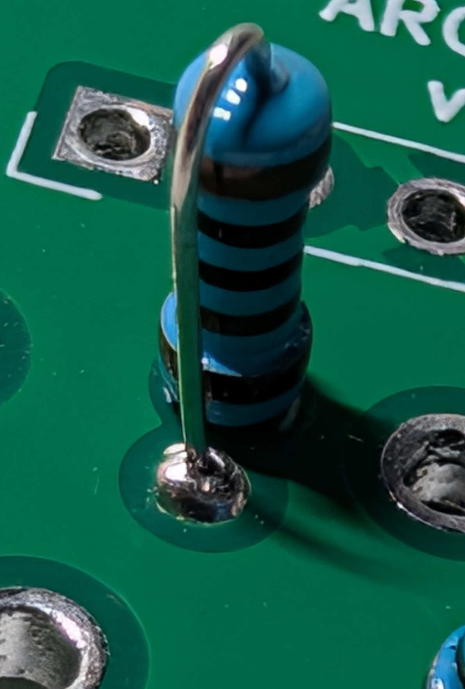
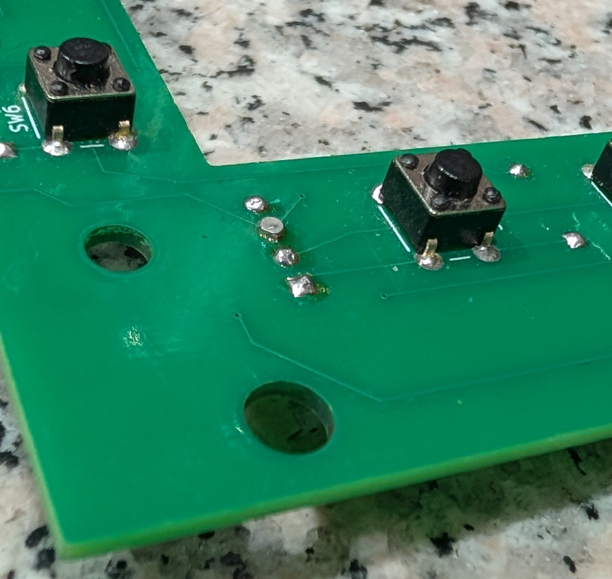

# ARC-210 Build Guide

**Last updated: November 12, 2026 at 9:54 PM MST (America/Denver)**

If you get stuck or something in this guide isn't clear, just ask me in [Discussions](https://github.com/dgdimick/ARC-210-DCS-Display/discussions). I once spent three hours on the phone talking a lady through installing a new garbage disposal. I'm happy to help you with your build, too.

I chose through-hole parts so you can solder these boards with basic tools.

**New to soldering?** There are plenty of YouTube videos that show how to solder through-hole parts. A soldering practice kit is also a great way to get comfortable with the iron before you start on the radio boards. If you bought a soldering practice kit, it may already include solder. [Find soldering practice kits on Amazon](https://www.amazon.com/s?k=learn+soldering).

If your hands are shaking while you solder, try cutting back on caffeine, taking a break, or setting the project aside for a while. I’ve found that if I drink too much coffee, my hands shake when I solder. Remember, this project should be fun.

**Never use plumbing solder or plumbing flux on a PCB.** Acid flux used for plumbing can leave corrosive residue that damages the board and component leads over time. Use 63/37 tin-lead solder with a rosin core made for electronics. [63/37 electronics solder on Amazon](https://www.amazon.com/WYcYcW-Solder-63-37-Electronic/dp/B0FFSK6TYC/ref=sxin_17_spotlighthaul_e14_dsk_hul_core?cv_ct_cx=electronic%2Bsolder&s=bazaar)

**Avoid breathing soldering fumes.** Work in a well-ventilated area and keep your face out of the rising fumes.

**Optional cleanup before soldering.** The PCBs usually arrive clean. If you see any residue from manufacturing, wipe it off with a clean, lint-free cloth lightly dampened with isopropyl rubbing alcohol. Let the board dry completely before soldering.

**Avoid overheating components.** If a joint needs more solder, such as a pin on a rotary switch connector, lift the iron and let the joint cool for a few seconds. Then reheat the pin and pad together and add the solder you need. Use this approach when soldering the rotary switches. Holding the iron on a pin too long can melt the plastic around it. A small amount of melting usually leaves the switch working. If you see any melting, check that the pin is still secure and the switch turns and works properly.

**Rotary encoder mounting tabs.** Use the largest soldering iron tip you have. Heat the tab and pad together, add solder, and lift the iron. Let the joint cool for a few seconds between passes, then repeat as needed until the solder wets both the tab and the pad.

**Check both sides after soldering.** These are two-layer PCBs with plated through-holes. Heat the pad and the pin together so the solder flows through the hole. Check that you can see solder around the pin on both sides of the board wherever the joint is visible. Use just enough to make the joint and check for bridges between adjacent pads. Inspect each solder joint before trimming the excess leads. Resolder any poor joints before cutting the leads.

*Through-hole soldering example. Solder applied from the back has flowed through the plated hole and is visible around the resistor lead on the component side. Check the joint on both sides of the PCB.*

Draft started October 29, 2026.

I’m putting this guide together to help you build your own ARC-210 panel using a Teensy 4.1, a 3.5-inch ILI9488 LCD display connected by SPI, and my control boards. If this is your first panel, start by reading through the guide, then take the build one board at a time. You’re welcome to ask questions in [Discussions](https://github.com/dgdimick/ARC-210-DCS-Display/discussions)—I’m happy to help where I can.

**This guide is still a work in progress.** When you see **Pending**, that’s something I still need to finish, test, measure, or photograph. Check those notes before ordering parts or making a permanent connection. I’ll fill in the details as I go.

I spend about **8 hours a day on my SIMPIT projects**, including working on the code, PCB design, assembly, and test fitting.

## Before you begin

- **PCB** means printed circuit board. The **BOM** is the bill of materials, or shopping list. You can use the ready-made manufacturing ZIP files without editing the KiCad designs.
- **Dry-fit** means putting parts together temporarily to check alignment and clearance. Do this before soldering or tightening anything that would make adjustment difficult, even though the full-panel fit check is described in step 7.
- Board labels such as **J1**, **R1**, and **D5** identify a connector, resistor, or diode. Each PCB has its own labels, so check which board a step refers to.
- **Front** means the side facing the faceplate; **back** means the side facing into the cockpit enclosure. Check each board’s instructions and pictures before fitting parts.
- A **HEX file** is the compiled firmware you load onto the Teensy. The supplied HEX files let you program it without compiling the source yourself. **TFT** refers to the LCD display in the wiring and test instructions.
- **GND** means ground, and **GPIO** means a controller input/output pin. Use the GPIO numbers printed on the Teensy when following the wiring instructions.
- I like to check my work one board at a time. Step 9 has the hardware tests, and step 10 walks you through the radio firmware and DCS-BIOS setup.

## Build status

| Area | Current status |
| --- | --- |
| Button Matrix PCB v3.2 | Final design; physical fit and button alignment confirmed; manufacturing files published |
| Rotary Encoder PCB v1.4 | Final design; physical fit confirmed; manufacturing files published |
| Rotary Switch PCB v2.0 | Assembled boards passed fit and functional testing |
| Main Board v1.1 | Gerber/drill files published; October 29 ERC/DRC and parity checks pass under saved settings; physical fit confirmed October 29, 2026; final review, current verification and assembled-board testing pending |
| Printed parts | All 17 parts have passed test fitting at 100%; Channel v4.2 was checked separately after the earlier complete-layout print |
| Electrical testing | Combined breadboard hardware test confirmed; assembled manufactured-board testing pending |
| Radio firmware | Menu/display preview available; complete physical-control integration and final in-DCS validation pending |

KiCad’s electrical and layout checks help me find design mistakes. I still need to test the assembled manufactured boards; the table above keeps that separate from the physical-fit checks.

## 1. Gather files, parts, and tools

1. Download the repository using **Code → Download ZIP**, then extract it. Keep each KiCad project folder and its libraries together.
2. Read the [parts list](../../parts/README.md), [BOM](../../parts/BOM.csv), and [PCB overview](../../PCBs/README.md). Use the current project versions listed above.
3. Gather a soldering iron, solder, flush cutters, multimeter, suitable hand tools, and access to a 3D printer. Have the PC Flights faceplate and specified controls available for fit checks.
4. Use a **USB Micro-B data cable** to power and program the Teensy 4.1 and carry USB communications. A charge-only cable will supply power but won’t let you program the Teensy or send radio data.

I recommend buying a **Teensy 4.1 with pre-soldered male header pins**: [SparkFun Teensy 4.1 (Headers)](https://www.sparkfun.com/teensy-4-1-headers.html), or this [Amazon Teensy 4.1 with Pins listing](https://www.amazon.com/PJRC-Teensy-4-1-with-Pins/dp/B08CTM3279) as an alternative example. The pre-fitted pins avoid having to solder the two long header rows yourself. The Main Board's two 1 × 24 female sockets are separate parts; they are optional but recommended for removing the Teensy during board upgrades or replacement.

For removable mounting, use **two 1 × 24 female PCB socket strips, 2.54 mm (0.1-inch) pitch**, on the Main Board, with matching male headers on the Teensy. Each strip has one row of 24 sockets; the Teensy’s pins plug into them. **These sockets are optional but recommended.** They allow the Teensy to be removed when replacing or updating the Main Board for new features, such as future LED support, or when the Teensy itself is damaged and needs replacement. **Pending:** final socket height, header lead length, standoff lengths, fastener quantities, and cable lengths must be confirmed against the finished assembly.

The build uses **five required boards**: one Main Board, one Button Matrix, one Rotary Encoder, and two Rotary Switch boards. A third Rotary Switch PCB is optional for the SQL On/Off switch, bringing the total to six.

The PCBs require mounting stand-offs. Use the [Vibit M3 nylon stand-off kit](https://www.amazon.com/dp/B0H1QS5Q6N), budgeted at **$10 per kit** in the BOM. Choose the total stand-off height by the clearance your build needs: approximately **22–26 mm**, depending on the SQL ON/OFF rotary switch shaft length. Dry-fit the boards, switch and faceplate, then select the height that provides the required clearance and correct shaft position before tightening the mounting hardware. The number of individual stand-offs remains pending.

**SQL On/Off:** I use the **C&K A12515RNZQ solder-lug rotary switch**, with its stop ring set to **two positions for 45° total travel**. Align the knob with the panel’s ON/OFF markings. See the [parts list](../../parts/README.md) for shaft-length and mounting details.

## 2. Print and check the mechanical parts

I’m offering a printed ARC-210 set to help builders who don’t have access to a 3D printer. See [ARC-210 3D-printing help](../ARC-210-Parts-Offers.md#printed-parts) for materials, availability, and how to request a free set and arrange shipping.

If you get a printed set from me, skip straight to the fit checks.

**The 17-part set has passed test fitting at 100% scale, with Channel v4.2 separately reprinted and confirmed after the earlier complete-layout test. The combined downloads now include that replacement.** Please keep checking [Project Updates](../Project-Updates.md) for changes.

The easiest starting point is the [master STL or 3MF download](../../Supporting%20STL%27s/README.md#complete-17-part-print-set), which contains all 17 required parts. Print the master set once at **100% scale**, or use the individual files below in the listed quantities. You don’t need to print both the master set and the individual parts.

| Part | Quantity / action |
| --- | --- |
| [Frequency knob v.10.1](../../Supporting%20STL%27s/Freq_Knob_v.10.1.stl) | Print five at 100%; confirm fit on each shaft |
| [Mode knob v.4](../../Supporting%20STL%27s/Mode_Knob_v.4.stl) | Print two at 100% |
| [Channel knob v.4.2](../../Supporting%20STL%27s/Channel_Knob_v.4.2.stl) | Print one at 100% |
| [TFT bracket v6.1](../../Supporting%20STL%27s/Deep_Bracket_v.6.1.stl) | Print one at 100% in flat black (matte) filament with supports |
| [Rotary Encoder spacer v.1](../../Supporting%20STL%27s/Rotary_Encoder_Spacer_v.1.stl) | **Print six**, one per encoder, to center the threads in the faceplate holes |
| [SQL shaft spacer v.5](../../Supporting%20STL%27s/Shaft_Spacer_v.5.stl) | **Print one; required in all installations** to support the longer SQL On/Off switch shaft |
| [SQL knob v1.2](../../Supporting%20STL%27s/SQL_Knob_v.1.2.stl) | Print one at 100%; retains the larger SQL socket |

The SQL shaft spacer is required whether using the optional SQL PCB or wiring directly to the switch's solder lugs. It is a separate part from the SQL knob.

**Channel v4.2 and SQL v1.2 have the same outside size and small side hole, but different shaft holes.** Print one of each at 100% scale. I’ve test-fitted both; see the [STL README](../../Supporting%20STL%27s/README.md) for the socket details and current downloads.

Dry-fit printed parts before permanent assembly. All current files print at 100% with the current hardware. Printer tolerances and shaft sizes vary, so check the fit on your own hardware. **Pending:** illustrated printing settings and a complete knob-to-control installation chart.

## 3. Order the PCBs

You can get a complete bare-PCB set from me or order directly from a manufacturer. See [ARC-210 bare PCB offer](../ARC-210-Parts-Offers.md#bare-pcb-set) for current pricing, contents, and terms. The manufacturing steps below explain the direct-order option. I’m happy to provide a free printed set whether you get your PCBs from me or elsewhere. Just cover shipping.

**JLCPCB’s prices shown in my comparison and demo are fabrication prices only. They do not include shipping, handling, tax, VAT, tariffs, duties, or other applicable fees.** Check the full delivered total before comparing a manufacturer order with a board set from me. The assembled Rotary Switch PCBs v2.0 passed both fit and functional testing. Testing of the full assembly is still pending.

### Estimated total build cost

I know the build cost may stretch some budgets. I’ve shared [my thoughts on the cost and development work](../../parts/README.md#estimated-total-build-cost) in the parts list, including roughly 480 hours working on the code, hardware design, PCB design, and testing and US$500 in extra development parts. My development-time estimate includes work I did before I started using ChatGPT, as well as over 120 hours using ChatGPT and Codex to help with some of the more complex code. I’m sure my dog [Cody](../Cody%20not%20happy.jpg) isn’t happy about this.

My PCBs are designed around the faceplate and layout I’m using, so they may not fit someone else’s custom panel. I’m sharing the [source code](../../Firmware/Source/Master_Program/README.md) so other builders can reuse it or adapt it to their own controls, displays, and wiring. Some changes may be needed, but I hope it gives people a useful starting point and saves them development time.

New aircraft support will require loading an updated HEX once; after that, I plan to switch between aircraft supported by that version without reflashing. This is still in development. See the [firmware version and aircraft-support plan](../../Firmware/Master%20Hex%20Files/README.md).

To help you budget, here are both PCB options using the same component estimates, including the PC Flights faceplate. **All amounts are in US dollars (USD).**

**My PCB offer is for bare boards only.** Buy the electronic components, faceplate, and wiring separately. I’m happy to provide a free printed set whether you get your PCBs from me or elsewhere. Just cover shipping. See [what’s included and the shipping and fee details](../ARC-210-Parts-Offers.md). The build totals below cover separate DIY purchases, not a kit I sell.

| PCB purchasing option | PCB cost (USD) | Estimated full DIY build cost (USD) |
| --- | ---: | ---: |
| JLCPCB: five copies of each of four designs (20 bare boards, including spares) | US$58.20 cart estimate | US$267.72–US$300.72 |
| [My six bare PCBs only (no components)](../ARC-210-Parts-Offers.md#bare-pcb-set) | **US$40.00**, plus shipping and handling | **US$249.52–US$282.52**, before shipping, handling, and applicable fees |

For availability, what’s included in my set, and shipping/VAT/import-fee details, see [ARC-210 bare PCB offer and separate 3D-printing help](../ARC-210-Parts-Offers.md#both-pcb-purchasing-options). I’m happy to provide a free printed set whether you get your PCBs from me or elsewhere. Just cover shipping.

**My PCB-set option:** Shipping and handling are separate. I’ll only collect VAT if I’m required to; buyers may still owe import VAT, customs duties, or carrier fees even if I don’t collect VAT. Delivery and applicable fees for the other components are also separate. Compare the final delivered totals for your location.

**The US$58.20 PCB allowance uses the November 1, 2026 cart estimate: US$41.10 fabrication + US$32.10 estimated shipping − a US$15.00 coupon.** Shipping shown in that cart is already included; don’t add it twice. Coupon eligibility and shipping vary. If the US$15.00 coupon is unavailable, add US$15.00 to the JLCPCB-based estimate. Any duties, taxes, VAT, carrier fees, or other charges not included in that cart subtotal may still apply, as may delivery charges for the other components. Check your own final checkout total before ordering. These are estimates rather than fixed kit prices; the updated JLCPCB option rounds to about **US$268–US$301** for budgeting. Tools, labor, and cockpit mounting fasteners are excluded.

See the [parts-cost breakdown](../../parts/README.md#estimated-build-cost) for the component prices and allowances. Compare the full delivered totals for your location before choosing how to buy the boards.

I use **JLCPCB** for PCB manufacturing. Follow my [step-by-step JLCPCB ordering guide](../PCB-Manufacturing-JLCPCB.md) for the ZIP files, board quantities, quote settings, preview checks, and engineering questions.

Download the manufacturing packages from the [Gerber and drill table](../../PCBs/README.md#gerber-and-drill-downloads). The Gerbers show the board layers, and the drill files tell the manufacturer where to make the holes. Upload the ZIP as it comes so the manufacturer gets both.

| Design | Boards per panel |
| --- | ---: |
| Main Board v1.1 | 1 |
| Button Matrix v3.2 | 1 |
| Rotary Encoder v1.4 | 1 |
| Rotary Switch v2.0 | 2 required, plus 1 optional for SQL On/Off |

Review the manufacturer's preview against the project outline and drill information. These control boards specify two layers and 1.6 mm thickness; consult each manufacturing README for details.

**Main Board Version 1.1:** [Gerber and drill package](../../PCBs/Master%20Board/Manufacturing/Main-Board-PCB-v1.1-Gerbers-Drill.zip) is available for a two-layer, 1.6 mm PCB. I’ve checked the physical fit of Main Board v1.1; final routing review, current verification and assembled-board testing remain pending; this is not yet a validated production release.

## 4. Assemble the Button Matrix PCB

**The current Button Matrix PCB v3.2 does not support LED backlighting.** I would need to redesign the button board with LED support, use suitable light-transmitting buttons, and make the required Main Board, power, and driver changes. I may revisit this after completing the ARC-164 and ARC-186 projects; there is no finished backlit button-board design or release date yet. See [Future Thoughts](../Future-Thoughts.md) for the lighting redesign plan.

I recommend using **male pin headers on the Teensy and matching female socket strips on the Main Board** so the controller can be unplugged. If I release a compatible replacement Main Board, you could move your existing Teensy to it rather than buy another controller, saving some money. Soldering the Teensy’s header pins directly into the Main Board does not provide that removable connection.

I hope to reuse the controls, socket-mounted Teensy, and faceplate in a future lighting upgrade, subject to compatibility checks. Replacement boards may need four layers and cost more; I have no finished design or release date. See [Future Thoughts](../Future-Thoughts.md).

Start with the [Button Matrix instructions and connector table](../../PCBs/Button%20Matrix/README.md). This board holds the sixteen front-panel buttons. Compare the front and back pictures there before fitting parts.

**The switches go on the front side of the PCB, facing the faceplate. The diodes and pin connectors go on the opposite (back) side.** The silkscreen markings show which side each component belongs on, so check those markings before soldering.

I’ll add photos of both sides as I build so you can see the switches, diodes, pin connectors, and board markings on the assembled PCB.

**Solder the diodes first.** Install the sixteen 1N4148 diodes (D5–D20) on the back of the PCB. Match each diode’s band (cathode) to the silkscreen before soldering.

On the front, use flush cutters to trim the diode leads as close to the PCB as you can without cutting into the pads. If a joint needs a touch-up after trimming, briefly touch it with a clean soldering iron tip to reflow the existing solder. It should leave a small, low bead around the lead so the PCB can sit flush behind the faceplate.

**Solder the J1 and J2 pin headers on the back before installing the buttons.** Then solder the sixteen **6 × 6 × 5 mm** momentary tactile switches on the front. Trim any protruding header pins on the front and clear away the clippings before mounting the PCB.

J1 and J2 are separate four-pin row and column connectors. They connect to the Main Board’s eight-pin J2 according to the project’s mapping. The 12 mm opening provides SQL switch pass-through clearance.

  

*Front of my Button Matrix PCB after trimming the diode leads and pin-header pins. Click the photo to view it full size.*

Button positions and the final v3.1 board fit have been checked. **Pending:** photographed soldering order, manufactured-board assembly, and electrical validation.

## 5. Assemble the Rotary Encoder PCB

Start with the [Rotary Encoder instructions](../../PCBs/Rotary%20Encoders/README.md). This board holds the five frequency encoders and the channel encoder. The encoders report which way you turn the knob. Step 6 covers the rotary switches with fixed positions.

**Solder the 14-pin J1 header on the back of the PCB first.** The rotary encoders will block access to the header’s solder pads once they’re installed. Install and solder the encoders after the header is in place. **Line up all the encoder pins with their holes before pressing the encoder into the PCB.** The pins bend easily and can break if forced.

- Use six Bourns **PEC11H-4220F-S0024** encoders.
- Fit the 14-pin connector using the board orientation shown in its project. J1 pins 13 and 14 are GND.
- The encoders' push-switch contacts are unused in this design.
- Fit the **six printed encoder spacers**, one at each encoder's threaded faceplate mounting section.

I’ve checked the PCB’s physical fit, and all six encoders worked in my combined hardware test. **Pending:** photographed assembly order and electrical testing of a manufactured board.

## 6. Assemble the Rotary Switch boards and SQL switch

Refer to the [Rotary Switch instructions](../../PCBs/Rotary%20Switches/README.md).

I use **10 mm and 13 mm deep-well sockets** to tighten the **mounting nuts on the rotary switches and encoders**. Pick the socket that fits the nut. The deep well gives the shaft room.

For each seven-position rotary switch (MAIN and MOD):

1. Solder all six 1 kΩ resistors (R1–R6) and the J1 pin header first. Leave JP1 open. Bend one lead of each resistor back alongside its body so the resistor stands upright. Put the two leads into the pair of small holes next to each other for that resistor. Resistors have no polarity, so either lead can go in either hole of the pair. If you’re unsure which holes to use, [ask me in Discussions](https://github.com/dgdimick/ARC-210-DCS-Display/discussions). I’m happy to help.
2. With the board disconnected from power, measure between the two pads marked **Test Here** in the [resistor ladder test photo](../../PCBs/Rotary%20Switches/README.md#check-the-resistor-ladder-before-installing-the-switch). The meter should read **close to 6 kΩ**.
3. Once the board passes the test, solder on the C&K **A12505RNCQ PCB-terminal switch**. Set the travel stops and knob orientation to suit the faceplate.

J1 pin 1 is 3.3 V, pin 2 is the signal, and pin 3 is GND.

The SQL On/Off switch is the **A12515RNZQ solder-lug version with the longer shaft**. It does not fit directly into the PCB-terminal footprint. **Set the stop ring to two positions for 45° total travel between SQL ON and OFF.**

- **Direct wiring:** connect the switch common to the Main Board SQL signal and the selected contact to GND. Choose the contact for the intended electrical ON/OFF states. Set the stop ring to **two positions with 45° total travel**.
- **Optional SQL PCB:** use wires from the solder-lug switch to the corresponding board connections. Leave R1–R6 unpopulated and bridge the board's JP1 ON/OFF solder jumper. Bridging means joining the jumper’s two pads with a small amount of solder. Follow its README for the contact and connector mapping.
- Fit **shaft spacer v.5 in either configuration**.

**Pending:** detailed SQL mounting photographs, final stack spacing and wire routing, and manufactured-board assembly validation.

## 7. Dry-fit the faceplate, TFT, and boards

Use the current TFT bracket, encoder spacers, switch shaft spacer, and faceplate. **Mount the TFT module upside down (rotated 180°)** so it clears the SQL shaft support spacer. The firmware rotates the image so it reads right side up from the front of the panel.

I redesigned the mount so the TFT screws right into the bracket. Use **four M3 × 6 mm screws** (M3 × 0.5 thread) and snug them up just enough to hold the display. **Don’t overtighten them.** It’s easy to strip the printed threads. The bracket is a tight fit on the Button Matrix PCB, but you’ll still need a little hot glue or silicone adhesive to secure the bracket to the board. Check button movement and shaft alignment before soldering or fastening makes adjustment difficult.

The Main Board component bodies face **away from the faceplate**, on the back of the board. Version 1.1 includes the switch shaft and anti-rotation openings and four 3.5 mm mounting holes.

**Main Board v1.1 physical fit confirmed — October 29, 2026.**

**Pending:** exact standoff and socket heights, fastener lengths, TFT-to-board component clearance, final assembly order, and step-by-step photographs.

### USB cable strain relief — zip-tie slots added; physical validation pending

The [current Main Board PCB](../../PCBs/Master%20Board/README.md#usb-cable-zip-tie-slots) includes **two 4 × 2 mm oblong slots** below the Teensy's USB connector, aligned with its two pin rows. These are Edge.Cuts milling contours and are intended for a small **2.5 mm zip tie**.

After checking the fit of the actual cable and boot, pass the tie through the two slots and around the cable so pulls are taken by the PCB support rather than the Micro-B connector. Avoid overtightening and leave enough slack to unplug the cable and remove the socketed Teensy for service.

**Pending:** physical fit and strain-relief validation with the actual cable/tie, an installation photograph, and the design/printing of any additional cable support. The slots are included in the published Main Board v1.1 manufacturing files; physical validation remains pending.

## 8. Main Board assembly and wiring — pending final validation

Use the [current Main Board schematic and README](../../PCBs/Master%20Board/README.md) for the detailed connections and board pictures. The table shows where everything connects on v1.1. I’ll add photos and fit details as I test the boards.

| Main Board connection | Purpose |
| --- | --- |
| J1 | TFT cable; **not straight-through**—use the [TFT cable mapping](../../parts/README.md#pin-headers-and-mating-connectors--october-12-2026) |
| J2 | Button Matrix cable; split into the two four-pin board connectors as documented |
| J4 | Rotary Encoder board; 14-pin cable, pin-for-pin |
| J9 — MODE | Signal on pin 2 to GPIO 15 / A1 through R2 |
| J10 — MASTER | Signal on pin 2 to GPIO 14 / A0 through R1 |
| SQL1 | Pin 1 SQL signal / GPIO 41; pin 2 GND |
| TP1 / TP2 | Alternative SQL solder-wire connections: TP1 signal, TP2 GND |

J9 and J10 each use pin 1 = 3.3 V, pin 2 = signal, pin 3 = GND. For the optional SQL switch-board cable, follow the specific SQL mapping in the parts README; do not assume all three-pin cables have identical use.

The Teensy is USB-powered. TFT VCC comes directly from **Teensy 3.3 V**. The removed protected 5 V circuit, Main Board JP1 selector, and C5/C6 are not fitted. C1/C2 and R1/R2 remain as rotary-input filters. The separate Rotary Switch PCB's JP1 is still used as described in step 6.

Use the **GPIO labels printed on the Teensy** for wiring instructions; they are not the KiCad symbol's pad numbers. Before connecting USB, leave power disconnected and check the cables with your multimeter. Confirm that each wire reaches its intended pin (continuity), connectors face the right way, and there are no unintended solder bridges or shorts between power and ground.

**Pending:** final Main Board fabrication and assembly, full-panel current verification, cable lengths and routing, and photographed continuity checks.

## 9. Run the Final Hardware Test

I tested the existing test firmware on my development hardware. **Validation of the assembled manufactured boards remains pending.**

1. Load the [Final Hardware Test HEX](../../Firmware/Test%20Code/ARC210_Final_Hardware_Test_v1.0_Teensy41.hex) and follow the [combined-test instructions](../../Firmware/Test%20Code/ARC210_Button_Test/README.md). This is the normal assembly test; you don’t need to run every individual test.
2. Check all sixteen buttons, six encoders in both directions, both seven-position switches, and TFT brightness control.
3. If something doesn’t work, try the [individual hardware test](../../Firmware/Test%20Code/README.md) for that part of the panel. It can help you narrow down where to look.
4. **Pending:** a documented end-to-end SQL On/Off test and complete manufactured-panel acceptance checklist. I still need to document SQL testing separately; the combined test alone does not confirm its operation.

Loading a test HEX replaces the firmware currently on the Teensy. The standalone tests do not require DCS. Disconnect USB before changing wiring.

## 10. Load the radio firmware and configure DCS-BIOS

Follow the [DCS-BIOS setup guide](../DCS-BIOS.md) for installation, the downloadable Lua files or manual edits, firmware loading, TekConnect, and connection checks. The [firmware README](../../Firmware/Master%20Hex%20Files/README.md) lists the current HEX and its features and limitations.

The current radio HEX is a **display/menu preview**; physical controls do not yet provide complete in-game radio operation. The screen can remain blank until powered-radio data arrives.

**Pending:** complete physical-control firmware integration, final DCS-BIOS installation screenshots, and full in-DCS acceptance testing on the manufactured assembly.

## 11. Troubleshooting and remaining guide work

| Symptom | First check |
| --- | --- |
| Teensy cannot be programmed or no USB data | Use a Micro-B data cable and the Teensy's programming button; follow the firmware loading instructions |
| TFT blank during a hardware test | Start with the hello test; verify J1's non-straight-through mapping and backlight GPIO 4 |
| TFT blank with radio firmware | Confirm powered-radio updates are being received, as explained in the firmware README |
| Encoder or matrix input missing | Check the connector mapping, continuity, diode polarity, and standalone test results |
| Rotary-switch readings wrong | Check 3.3 V/signal/GND, resistor population, JP1 configuration, and travel stops |

**Pending:** assembly photographs, annotated connector-orientation diagrams, measured mounting hardware, validated manufactured-board procedures, and final acceptance results.

If you get stuck, tell me which step you’re on, the board version, and what you’re seeing in [GitHub Discussions](https://github.com/dgdimick/ARC-210-DCS-Display/discussions). A clear photo can help me understand the problem. Questions and progress photos are welcome, even if this is your first panel.

## Sharing code and improvements

My main firmware code is shared under the [MIT License](../../Docs/LICENSE-MIT.txt), and I’m happy to provide it to anyone who asks. You can also find the [published source here](../../Firmware/Source/Master_Program/README.md). If you adapt it or add improvements, I’d love to work with you and bring useful changes back into this project so other builders—and my other panel projects—can benefit too.

Please share your changes through a pull request or get in touch in [Discussions](https://github.com/dgdimick/ARC-210-DCS-Display/discussions). Contributing changes back is welcome, but it isn’t an extra condition of the MIT License. Third-party code keeps its own license. The PCB designs retain their separate hardware license.

[Back to documentation](../README.md) · [Back to main README](../../README.md)
