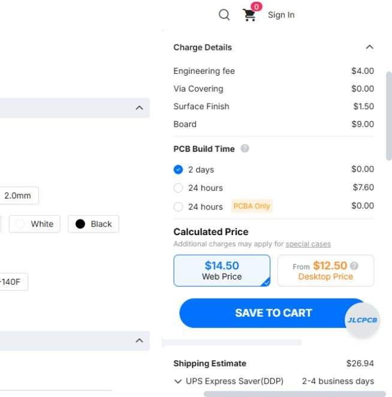

[Back to the Build Guide](Build%20Guide/README.md#3-order-the-pcbs) · [PCB downloads](../PCBs/README.md#gerber-and-drill-downloads)

# Ordering the ARC-210 PCBs from JLCPCB

**Last updated: October 31, 2026 at 1:37 AM MDT (America/Denver)**

I use [JLCPCB](https://jlcpcb.com/) to manufacture my PCBs. I’ve put these steps together so you can order the bare boards and solder the components yourself, even if this is your first panel. You don’t need to edit the KiCad designs or generate manufacturing files: use the ZIP downloads below.

I’m not affiliated with JLCPCB. This guide follows its [ordering instructions](https://jlcpcb.com/help/article/instructions-for-ordering), checked October 30, 2026. Website labels, available quantities, prices, and delivery options may change. The board specifications below come from this project’s files; suggested choices are not a record of every option on my previous order.

**The current Button Matrix PCB v3.2 does not support LED backlighting.** I would need to redesign the button board and make the associated power and driver changes to add it. I have no finished design or release date for that possible future feature. The manufacturing downloads in this guide are for the current unlit board. See [Future Thoughts](Future-Thoughts.md) for the possible lighting redesign.

I may need to use **four-layer PCBs for both the replacement Main Board and button board**, which could increase the cost of both replacement boards. I haven’t confirmed the layer requirements or priced that redesign yet. This possible extra cost is not included in the current build estimates or my US$40 bare-PCB set price.

I recommend using **male pin headers on the Teensy and matching female socket strips on the Main Board** so the controller can be unplugged. If I release a compatible replacement Main Board, you could move your existing Teensy to it rather than buy another controller, saving some money. Soldering the Teensy’s header pins directly into the Main Board does not provide that removable connection.

My aim would be to reuse the **rotary encoders, rotary switches, socket-mounted Teensy, faceplate, and other parts that aren’t mounted on the Main Board or Button Matrix PCB**, so upgrading would not mean buying a whole new panel. I still need to confirm compatibility as I develop the redesign. The current opaque buttons would need suitable light-transmitting replacements for illuminated legends.

## Cost comparison and why I’m staying with JLCPCB

I checked the ordering options and prices on **October 30, 2026** to see whether buying exactly one radio’s set would save money. These are **bare-board fabrication estimates excluding shipping, handling, tax, VAT, tariffs, duties, and other applicable fees**, not paid-order totals or guaranteed quotes. I’ve kept the original currencies rather than implying a fixed exchange rate. For my own sales, if I’m not required to collect VAT, I won’t.

| Manufacturer | What the order provides | Estimated fabrication cost |
| --- | --- | ---: |
| [JLCPCB](https://cart.jlcpcb.com/quote) | Five copies of each of the four designs: **20 boards total** | **US$41.10** |
| [Eurocircuits PCB proto](https://www.eurocircuits.com/services/pcb-proto/) | Exactly one required five-board set: one Main, one Button Matrix, one Encoder, and two Rotary Switch boards | **About €241** |
| Eurocircuits PCB proto | One six-board set, adding the optional SQL Rotary Switch board | **About €245** |
| [OSH Park two-layer prototype service](https://docs.oshpark.com/services/two-layer/) | Three copies of each of the four designs: **12 boards total** | **About US$319** |

The JLCPCB estimate adds the four online calculator prices: **US$13.80 Main Board + US$14.50 Button Matrix + US$7.60 Rotary Encoder + US$5.20 Rotary Switch**, each for five copies. The demo used the actual Button Matrix v3.2 manufacturing ZIP; the other estimates used the project’s board dimensions. Settings were two layers, 1.6 mm FR-4, green mask, white silkscreen, 1 oz copper, and lead-free HASL. The small Rotary Switch quote also included a US$0.10 edge-rounding charge. File review, quote settings, and order-specific charges can change these figures. Five Rotary Switch copies cover either the two required boards or all three including SQL, so that optional board does not require another design order in this comparison.

Eurocircuits’ calculator estimates used its standard **PCB proto** service with a three-working-day lead time. The approximate five-board total was **€68.94 Main + €71.17 Button Matrix + €47.06 Encoder + €53.54 for two Rotary Switch boards**; three Rotary Switch boards were €57.66. The Main Board estimate used rounded-up 133 × 130 mm dimensions. Its standard **1.55 mm board thickness** differs from this project’s 1.6 mm specification, so mechanical and manufacturing compatibility still needs review before treating it as a replacement ordering route. Shipping requires a destination/account quote; the displayed 21% VAT-inclusive prices were not used here. For my own sales, if I’m not required to collect VAT, I won’t.

The OSH Park figure is calculated from the four designs’ rectangular dimensions and its published **US$5 per square inch for three copies**. It is an area-based estimate, not a Gerber-reviewed quote. Its standard service specifies 1.6 mm boards, 1 oz copper, purple mask, and ENIG finish, so the finish and color differ from the JLCPCB comparison.

**I’m sticking with JLCPCB because the estimated fabrication cost is much lower, even though I get extra boards.** Ordering exactly the number I need would reduce leftovers, but the single-set option I checked costs considerably more. The extras also give me spare boards if I need to replace one or make a mistake during assembly. I already use JLCPCB, so keeping the same ordering process makes the build easier to document and repeat.

I’ll still compare the **delivered total**, including shipping and any applicable tax or import charges, before ordering. The [parts-cost estimate](../parts/README.md#estimated-build-cost) uses this US$41.10 fabrication subtotal, with shipping, handling, tax, VAT, and other applicable fees excluded. A combined manufacturing panel might offer another saving, but I haven’t quoted a verified combined package here, and it would not automatically remove the five-copy minimum. For my own sales, if I’m not required to collect VAT, I won’t.

### JLCPCB Button Matrix demo quote

I uploaded **Button Matrix v3.2** and checked the bare-board settings. JLCPCB detected two layers and approximately **143.53 × 129.25 mm**. With five boards and lead-free HASL selected, the website showed **US$14.50** for fabrication: US$4.00 engineering, US$9.00 boards, and US$1.50 finish. The custom quantity field did not accept a one-board order in this demo.

  

*My Button Matrix quote demonstration. Click the picture to enlarge it. The screenshot also shows a shipping estimate and a separate desktop-app promotional price; the comparison above uses the web fabrication price only. Nothing was added to the cart or ordered during the demo.*

## Buying a complete PCB set from me

**Before placing your own manufacturing order, contact me about buying a complete set of bare PCBs for one radio.** I’m offering this as a **convenient complete set for one radio**: you get the boards you need without managing four separate PCB design uploads or ordering the manufacturer’s minimum quantity of every design. **Any savings depend on your location, shipping, handling, tax, VAT, tariffs, and other applicable fees**, so compare the full delivered totals. I’m not promising that my set will always be cheaper than ordering directly. For my own sales, if I’m not required to collect VAT, I won’t.

My own order for all the boards cost **about US$75**. That is an approximate total for my board order, not the manufacturing cost of a single six-board set or a guaranteed quote for another builder. My complete-set price remains **US$40 plus shipping and handling**.

My **complete six-board ARC-210 bare-PCB set is US$40, plus shipping and handling**. It includes one Main Board, one Button Matrix, one Rotary Encoder, and three Rotary Switch boards, including the optional SQL board. Ask in [GitHub Discussions](https://github.com/dgdimick/ARC-210-DCS-Display/discussions) about availability and a shipping quote. These are bare boards for you to populate and solder; components, the faceplate, printed parts, and assembly are not included. Assembled-board electrical testing is still pending. Compare the delivered totals for your location rather than assuming a guaranteed saving.

I won’t add a separate tax charge to my **US$40 PCB-set price**. I’ve already paid tax on my board order, and I’m offering these sets as part of my personal SIMPIT project rather than a commercial venture. Shipping and handling are separate. For VAT on my PCB sets, I’ll only collect it if required. If I’m not required to collect VAT, I won’t. Any charges imposed by a carrier, customs authority, or other supplier are outside my PCB-set price.

You’re also welcome to order directly from a manufacturer using the files and steps below. I’ll keep sharing the project files and build guidance whichever route you choose.

## No access to a 3D printer?

If you don’t have access to a 3D printer and that is stopping you from building the panel, I’ll send you **one complete 17-part printed set for US$3 (three US dollars), plus shipping and any applicable VAT**. I’ll print the **mounting bracket in black PETG** and the **remaining parts in gray PETG**. I want the lack of a printer to be one less obstacle to building your SIMPIT. For my own sales, if I’m not required to collect VAT, I won’t.

Get in touch through [Discussions](https://github.com/dgdimick/ARC-210-DCS-Display/discussions) so we can arrange the set and shipping. See the [printed-parts offer](../parts/README.md#no-access-to-a-3d-printer) for details. Shipping and any applicable VAT are not included in the US$3 price. For my own sales, if I’m not required to collect VAT, I won’t.

## Estimated total build cost

I’m distressed by the total cost of this project, and I worry it may put the build beyond some people’s budgets. I want to be open about that so you can decide whether it fits your budget before buying parts. Considering the controls, display, and functionality the panel is designed to provide, I still feel it’s worth the cost.

I’ve spent about two months working on the code, averaging four hours a night—roughly **240 hours**. I’m sharing the source code for free so other builders don’t have to do all that development work themselves. The parts still cost money, but I hope the time and effort this saves helps make the project worthwhile.

My PCBs are designed around the faceplate and layout I’m using, so they may not fit someone else’s custom panel. I’m sharing the [source code](../Firmware/Source/Master_Program/README.md) so other builders can reuse it or adapt it to their own controls, displays, and wiring. Some changes may be needed, but I hope it gives people a useful starting point and saves them development time.

I’ve also spent about **US$500 on extra parts during development**. Buying more parts as I work toward a finished project adds up. That is my development expense; it is not an extra charge to builders or part of the estimated cost to build one panel. I’m still very happy to share this project with others. We all enjoy adding to our SIMPITs, no matter how big or small they are.

One thing I’m very pleased about is that I’m developing the same ARC-210 panel hardware for every aircraft I’ve planned to support, including the A-10C II and C-130J. I’m designing a shared code base that will automatically use the appropriate controls and display data for the aircraft you’re flying, so you won’t need to reflash the Teensy when switching between supported aircraft—just fly the aircraft. **This automatic aircraft support is still being developed and tested; it is not a completed feature yet.** Aircraft-specific DCS-BIOS mappings will be handled within that shared setup.

I’ll label radio HEX downloads with the aircraft they support and a version number, increasing the version whenever I publish updated firmware so you can tell releases apart. Each new aircraft-support release will retain support for the previously supported aircraft. Adding an aircraft will require loading the updated HEX once, using the same Teensy Loader procedure as the first flash while the panel is connected by USB. After that, switching between aircraft included in that version will not require reflashing. **This cumulative aircraft support and automatic selection are still being developed and tested.**

Here is the estimated cost of the complete panel using either PCB purchasing option. Both totals use the same component estimates and include the PC Flights faceplate. **All amounts in this table are in US dollars (USD).**

| PCB purchasing option | PCB cost (USD) | Estimated total parts cost (USD) |
| --- | ---: | ---: |
| JLCPCB: five copies of each of four designs (20 bare boards, including spares) | US$41.10 | US$250.62–US$283.62 |
| My complete six-board bare-PCB set for one radio | US$40.00 | US$249.52–US$282.52 |

**Shipping and handling are separate and are not included in either total.** I won’t add a separate tax charge to my PCB-set price. Other suppliers or delivery authorities may apply their own taxes, VAT, tariffs, duties, or fees; those charges are outside these estimates. These are estimates rather than fixed kit prices; either option rounds to about **US$250–US$285** for budgeting. Tools, labor, and cockpit mounting fasteners are excluded. For my own sales, if I’m not required to collect VAT, I won’t.

See the [parts-cost breakdown](../parts/README.md#estimated-build-cost) for component prices and allowances. Compare the full delivered totals for your location before choosing how to buy the boards.

**SQL switch replacement pending:** The SQL On/Off switch I’m currently using does not have the correct arc of movement for the panel. I’m looking for a suitable replacement. When I find one, I’ll announce it in [Project Updates](Project-Updates.md) and update the [parts list](../parts/README.md).

## 1. Choose the files and quantities

There are **four different PCB designs**, but one radio panel uses **five boards**, or **six with the optional SQL board**:

| Design | Current version and manufacturing ZIP | Boards used in one radio panel |
| --- | --- | ---: |
| Main Board | [v1.1 ZIP](../PCBs/Master%20Board/Manufacturing/Main-Board-PCB-v1.1-Gerbers-Drill.zip) | 1 |
| Button Matrix | [v3.2 ZIP](../PCBs/Button%20Matrix/Manufacturing/Button-Matrix-PCB-v3.2-Gerbers-Drill.zip) | 1 |
| Rotary Encoder | [v1.4 ZIP](../PCBs/Rotary%20Encoders/Manufacturing/Rotary-Encoder-PCB-v1.4-Gerbers-Drill.zip) | 1 |
| Rotary Switch | [v2.0 ZIP](../PCBs/Rotary%20Switches/Manufacturing/Rotary-Switch-PCB-v2.0-Gerbers-Drill.zip) | 2, or 3 with the optional SQL board |

Download each ZIP to your computer and keep it zipped for upload. These are the manufacturing ZIPs, rather than GitHub’s whole-project **Code → Download ZIP** file. Each contains the board layers and drill data JLCPCB needs.

**You need a separate order item for each of the four PCB designs:** Main Board, Button Matrix, Rotary Encoder, and Rotary Switch. Upload each design’s ZIP and configure its quantity separately. You can put all four items in the same cart and checkout together; you don’t need four separate payments or shipments. The Rotary Switch boards all use the same file, so order enough copies of that design for the two required switches, or three with the optional SQL board.

**JLCPCB normally defaults to five copies of each PCB design.** Check the selected quantity and the available minimum on each quote before ordering. **Quantity means copies of that design, not complete radio sets.** Ordering five of each of the four designs gives you twenty individual boards; one radio uses five boards, or six with the optional SQL board, leaving spares.

I’d like builders to be able to order just **one complete set for one radio**, rather than five copies of every design. I’m investigating whether a combined manufacturing panel or another ordering option can reduce the extras and delivered cost. A combined panel may still have a five-panel minimum, so putting the designs together does not automatically make a single-set order possible. I’ll document a checked ordering route before recommending it.

## 2. Upload a manufacturing ZIP

1. Open [JLCPCB](https://jlcpcb.com/) and choose its PCB quote/order service.
2. Choose **Add Gerber file** or **Select Gerber files** and upload one of the manufacturing ZIPs above.
3. Let the site process the file. Check that it recognizes a two-layer board and shows the expected outline and dimensions.
4. Keep this quote for one individual board design. For these separate-board ZIPs, use **Single PCB**, with **one design** in the file, rather than a panelization option.
5. Set the quantity and check the specifications below. Repeat for each of the other three designs.

You don’t need to upload the schematic, STL files, firmware, component shopping list, or an assembly placement file for this bare-board order.

## 3. Check the manufacturing settings

| Setting | What to use or check |
| --- | --- |
| Base material | FR-4 rigid PCB |
| Copper layers | **2** |
| Board thickness | **1.6 mm** |
| Board size | Read from the uploaded outline; compare with the board drawing. Don’t change the dimensions to fit a price bracket. |
| Delivery format | **Single PCB** for each of the separate-design ZIPs linked above |
| Different designs | **1** per uploaded ZIP |
| Quantity | Copies of that design; allow for JLCPCB’s current minimum |
| Solder mask and silkscreen | Green mask and white silkscreen are a straightforward choice matching my build photo. Keep the markings readable; the Button Matrix uses markings on both sides. |
| Copper weight | Standard **1 oz** outer copper is a starting choice matching the approximately 35 µm copper in the project stackup. Check the quote and current manufacturing notes. |
| Surface finish | Choose a solderable finish, such as lead-free HASL. This is a suggested hand-soldering option, not a confirmed record of my previous order’s finish. |
| PCB assembly | Leave **PCB Assembly** off; this guide is for bare boards that you populate yourself. |
| SMT stencil | Not needed for the planned through-hole hand assembly. |

The Gerber job file’s finish entry is `None`, meaning the project has not specified a finish there. It is not an instruction to order bare, unfinished copper. Review the actual finish selected in the quote.

You can leave unrelated extra services unselected unless you specifically need them. Compare the full total, including shipping, handling, tax, VAT, and other applicable fees; a low advertised board price is not the complete delivered cost. The [parts list](../parts/README.md#estimated-build-cost) has my build-cost estimates. For my own sales, if I’m not required to collect VAT, I won’t.

## 4. Inspect the preview before checkout

I recommend taking a moment with each board’s preview:

- Compare the outline, mounting holes, and openings with the [PCB reference pages](../PCBs/README.md).
- Check that copper, solder mask, drill holes, and front/back silkscreen are present. Front and back previews may be viewed from different directions; don’t mirror the uploaded files yourself.
- On the **Button Matrix v3.2**, check the **12 mm non-plated SQL pass-through hole** and the four mounting holes. The switches belong on the front; diodes and pin connectors belong on the back, as shown by the silkscreen.
- On the **Main Board v1.1**, check its switch clearances, mounting holes, and the two USB cable zip-tie slots.
- Check the displayed quantities and file versions for all four cart items before submitting an order.

If an outline, hole, or layer looks wrong, check the uploaded ZIP and ask in [Discussions](https://github.com/dgdimick/ARC-210-DCS-Display/discussions) before ordering. JLCPCB notes that fabrication follows the Gerber data; a README or note in the ZIP does not replace correct manufacturing geometry.

## 5. If JLCPCB asks an engineering question

JLCPCB previously asked me about overlapping drill and outline definitions for the Button Matrix’s SQL clearance hole. I corrected the source and released **v3.2**, removing the duplicate outline circle and retaining the intended **12 mm non-plated drill hole**.

Use the current v3.2 ZIP for new orders. If JLCPCB asks about a conflict, check the filename and the marked location before replying. Don’t apply an answer from an older order to a different hole. Share the engineer’s marked picture in Discussions if you need a hand identifying it.

## 6. Keep the order details and check the delivered boards

After reviewing the cart, choose the shipping option and checkout details that suit you. Keep a copy of the uploaded ZIP versions and the selected board specifications so you can identify what arrives and repeat the order later.

When the boards arrive, check the revision markings, quantities, outline, holes, and visible manufacturing quality against the project files. Dry-fit before permanent assembly, then follow the [Build Guide](Build%20Guide/README.md). I still need to complete electrical testing of the assembled manufactured boards; a good-looking board or a passed design check is not the same as an electrically tested panel.

I’ll take assembly pictures as I build, including both sides of the Button Matrix board, and add them to the guides. Questions and first-build photos are welcome in [Discussions](https://github.com/dgdimick/ARC-210-DCS-Display/discussions).

## About combined manufacturing panels

The separate-board ZIPs above are the route covered here. A combined manufacturing panel has its own outline, separation method, and design-count requirements. Don’t upload several independent ZIPs as though they were one panel, or select **Panel by JLCPCB** expecting it to combine all four different designs automatically. JLCPCB’s [panel-ordering guide](https://jlcpcb.com/help/article/how-do-i-order-a-panel) describes duplication of one design, and its [different-design guidance](https://jlcpcb.com/help/article/different-design-in-your-pcb-files) explains additional design charges. A combined-panel order needs its own checked package and instructions.

## Sharing code and improvements

My main firmware code is shared under the [MIT License](../Docs/LICENSE-MIT.txt), and I’m happy to provide it to anyone who asks. You can also find the [published source here](../Firmware/Source/Master_Program/README.md). If you adapt it or add improvements, I’d love to work with you and bring useful changes back into this project so other builders—and my other panel projects—can benefit too.

Please share your changes through a pull request or get in touch in [Discussions](https://github.com/dgdimick/ARC-210-DCS-Display/discussions). Contributing changes back is welcome, but it isn’t an extra condition of the MIT License. Third-party code keeps its own license. The PCB designs retain their separate hardware license.

## Local SIMPIT help

If you’re local to me in **New Mexico, USA**, I’d be happy to meet up and provide whatever help I can with your SIMPIT. Get in touch through [Discussions](https://github.com/dgdimick/ARC-210-DCS-Display/discussions) so we can talk about your build and arrange a time.
