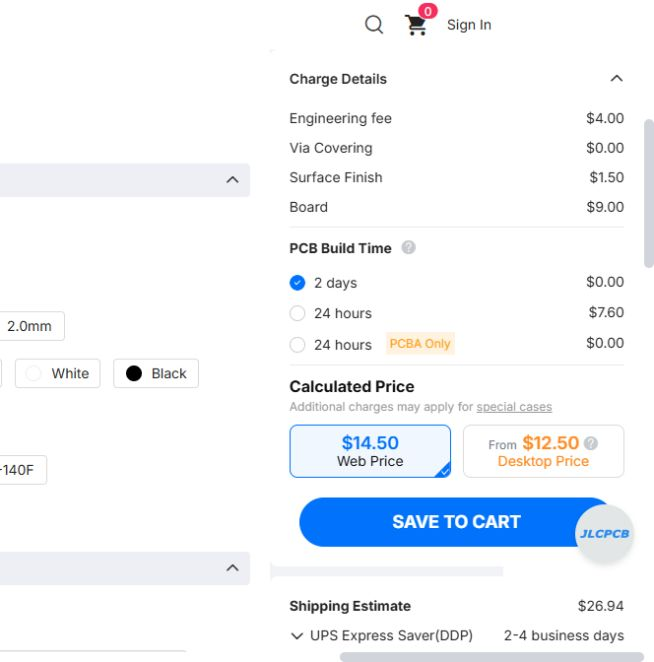

[Back to the Build Guide](Build%20Guide/README.md#3-order-the-pcbs) · [PCB downloads](../PCBs/README.md#gerber-and-drill-downloads)

# Ordering the ARC-210 PCBs from JLCPCB

**Last updated: November 1, 2026 at 7:00 PM MST (America/Denver)**

I use [JLCPCB](https://jlcpcb.com/) to manufacture my PCBs. I’ve put these steps together so you can order the bare boards and solder the components yourself, even if this is your first panel. You don’t need to edit the KiCad designs or generate manufacturing files: use the ZIP downloads below.

I’m not affiliated with JLCPCB. This guide follows its [ordering instructions](https://jlcpcb.com/help/article/instructions-for-ordering), checked October 30, 2026. Website labels, available quantities, prices, and delivery options may change. The board specifications below come from this project’s files; suggested choices are not a record of every option on my previous order.

**The current Button Matrix PCB v3.2 does not support LED backlighting.** I would need to redesign the button board and make the associated power and driver changes to add it. I have no finished design or release date for that possible future feature. The manufacturing downloads in this guide are for the current unlit board. See [Future Thoughts](Future-Thoughts.md) for the possible lighting redesign.

I recommend using **male pin headers on the Teensy and matching female socket strips on the Main Board** so the controller can be unplugged. If I release a compatible replacement Main Board, you could move your existing Teensy to it rather than buy another controller, saving some money. Soldering the Teensy’s header pins directly into the Main Board does not provide that removable connection.

I hope to reuse the controls, socket-mounted Teensy, and faceplate in a future lighting upgrade, subject to compatibility checks. Replacement boards may need four layers and cost more; I have no finished design or release date. See [Future Thoughts](Future-Thoughts.md).

## Cost comparison and why I’m staying with JLCPCB

I checked the manufacturer comparison on **October 30, 2026** and rechecked JLCPCB by uploading all four current manufacturing ZIPs on **November 1, 2026** to see whether buying exactly one radio’s set would save money. These are **bare-board fabrication estimates excluding shipping, handling, tax, VAT, tariffs, duties, and other applicable fees**, not paid-order totals or guaranteed quotes. I’ve kept the original currencies rather than implying a fixed exchange rate.

| Manufacturer | What the order provides | Estimated fabrication cost |
| --- | --- | ---: |
| [JLCPCB](https://cart.jlcpcb.com/quote) | Five copies of each of the four designs: **20 boards total** | **US$41.10** |
| [Eurocircuits PCB proto](https://www.eurocircuits.com/services/pcb-proto/) | Exactly one required five-board set: one Main, one Button Matrix, one Encoder, and two Rotary Switch boards | **About €241** |
| Eurocircuits PCB proto | One six-board set, adding the optional SQL Rotary Switch board | **About €245** |
| [OSH Park two-layer prototype service](https://docs.oshpark.com/services/two-layer/) | Three copies of each of the four designs: **12 boards total** | **About US$319** |

The uploaded-file JLCPCB fabrication quotes add up to: **US$13.80 Main Board + US$14.50 Button Matrix + US$7.60 Rotary Encoder + US$5.20 Rotary Switch**, each for five copies. I uploaded Main Board v1.1, Button Matrix v3.2, Rotary Encoder v1.4, and Rotary Switch v2.0 separately, then added all four to one signed-in cart. The cart confirmed **US$41.10 for fabrication**. This supersedes the earlier estimate that uploaded only the Button Matrix ZIP and used dimensions for the other boards. Settings were two layers, 1.6 mm FR-4, green mask, white silkscreen, 1 oz copper, and lead-free HASL. The small Rotary Switch quote also included a US$0.10 edge-rounding charge. File review, quote settings, and order-specific charges can change these figures. Five Rotary Switch copies cover either the two required boards or all three including SQL, so that optional board does not require another design order in this comparison.

Eurocircuits’ calculator estimates used its standard **PCB proto** service with a three-working-day lead time. The approximate five-board total was **€68.94 Main + €71.17 Button Matrix + €47.06 Encoder + €53.54 for two Rotary Switch boards**; three Rotary Switch boards were €57.66. The Main Board estimate used rounded-up 133 × 130 mm dimensions. Its standard **1.55 mm board thickness** differs from this project’s 1.6 mm specification, so mechanical and manufacturing compatibility still needs review before treating it as a replacement ordering route. Shipping requires a destination/account quote; the displayed 21% VAT-inclusive prices were not used here.

The OSH Park figure is calculated from the four designs’ rectangular dimensions and its published **US$5 per square inch for three copies**. It is an area-based estimate, not a Gerber-reviewed quote. Its standard service specifies 1.6 mm boards, 1 oz copper, purple mask, and ENIG finish, so the finish and color differ from the JLCPCB comparison.

**I’m sticking with JLCPCB, but I want builders to budget for the delivered cost, not just fabrication.** The cart estimate I’m using is **US$58.20 after the displayed US$15.00 coupon**. The manufacturer table above compares fabrication only; I haven’t checked equivalent delivered quotes from the other suppliers. The extras also give me spare boards if I need to replace one or make a mistake during assembly. I already use JLCPCB, so keeping the same ordering process makes the build easier to document and repeat.

I’ll still compare the **delivered total**, including shipping and any applicable tax or import charges, before ordering. The [parts-cost estimate](../parts/README.md#estimated-build-cost) now uses **US$58.20 for the JLCPCB order**, including the displayed shipping and coupon; other component delivery and any additional import-related charges remain separate. A combined manufacturing panel might offer another saving, but I haven’t quoted a verified combined package here, and it would not automatically remove the five-copy minimum.

### Uploaded-file checkout estimate — November 1, 2026

I uploaded **all four manufacturing ZIPs** and added five copies of each design to **one cart**: 20 bare boards, with spares after building one radio. I’m using the **US$58.20 cart estimate**, which included the displayed shipping and coupon:

| Charge | Amount (USD) |
| --- | ---: |
| Main Board v1.1, five boards | US$13.80 |
| Button Matrix v3.2, five boards | US$14.50 |
| Rotary Encoder v1.4, five boards | US$7.60 |
| Rotary Switch v2.0, five boards | US$5.20 |
| **Fabrication subtotal** | **US$41.10** |
| Estimated shipping shown in cart | US$32.10 |
| Applied coupon | −US$15.00 |
| **Cart estimate used in the build budget** | **US$58.20** |

This is an **estimate, not a paid order or a guaranteed delivered price**. I did not submit or pay for an order. Coupon eligibility and shipping costs depend on the account, destination, and selected service. Without the US$15.00 coupon, the same fabrication and shipping would be US$73.20, so add US$15.00 to the JLCPCB-based build budget. Any duties, taxes, VAT, carrier fees, or other charges not included in this cart subtotal may still apply at checkout or delivery. Check your own final checkout total; don’t add the shipping already included in this estimate twice.

The current JLCPCB-based panel budget is **US$267.72–US$300.72**, or about **US$268–US$301**, including this PCB cart estimate and the faceplate. Delivery charges for the other components and any additional applicable fees remain separate.

Uploaded-file fabrication quote screenshots: [Main Board](../images/JLCPCB-Main-v1.1-Quote-2026-11-01.jpg), [Button Matrix](../images/JLCPCB-Button-v3.2-Quote-2026-11-01.jpg), [Rotary Encoder](../images/JLCPCB-Encoder-v1.4-Quote-2026-11-01.jpg), [Rotary Switch](../images/JLCPCB-Switch-v2.0-Quote-2026-11-01.jpg). These screenshots document fabrication prices, not the complete delivered cost.

### JLCPCB Button Matrix demo quote

I uploaded **Button Matrix v3.2** and checked the bare-board settings. JLCPCB detected two layers and approximately **143.53 × 129.25 mm**. With five boards and lead-free HASL selected, the website showed **US$14.50** for fabrication: US$4.00 engineering, US$9.00 boards, and US$1.50 finish. The custom quantity field did not accept a one-board order in this demo.

  

*My Button Matrix quote demonstration. Click the picture to enlarge it. The screenshot also shows a shipping estimate and a separate desktop-app promotional price; the comparison above uses the web fabrication price only. Nothing was added to the cart or ordered during the demo.*

## Buying a complete PCB set from me

See my [ARC-210 PCB and printed-parts offers](ARC-210-Parts-Offers.md) for current prices, what’s included, materials, availability, shipping, VAT, and import charges. **These offers are for the ARC-210 only; ARC-164 and ARC-186 sets are not available yet.**

## No access to a 3D printer?

I offer separate 3D-printing help for builders whose lack of printer access is preventing their build. This supplies printed plastic only, not electronic components or a complete kit; buy the other components separately. See [ARC-210 parts offers](ARC-210-Parts-Offers.md#printed-parts) for the current price, PETG colors, availability, shipping, VAT, and import-charge details.

## Estimated total build cost

I know the build cost may stretch some budgets. I’ve shared [my thoughts on the cost and development work](../README.md#estimated-total-build-cost) in the main README, including the roughly 240 hours of coding and US$500 in extra development parts I’ve put into sharing this project.

My PCBs are designed around the faceplate and layout I’m using, so they may not fit someone else’s custom panel. I’m sharing the [source code](../Firmware/Source/Master_Program/README.md) so other builders can reuse it or adapt it to their own controls, displays, and wiring. Some changes may be needed, but I hope it gives people a useful starting point and saves them development time.

New aircraft support will require loading an updated HEX once; after that, I plan to switch between aircraft supported by that version without reflashing. This is still in development. See the [firmware version and aircraft-support plan](../Firmware/Master%20Hex%20Files/README.md).

Here are both estimated panel parts costs, including the PC Flights faceplate. **All amounts in this table are in US dollars (USD).**

**My PCB offer is for bare boards only.** Buy the electronic components, faceplate, and wiring separately; printed parts are a separate option. See [what’s included and the shipping and fee details](ARC-210-Parts-Offers.md). The build totals below cover separate DIY purchases, not a kit I sell.

| PCB purchasing option | PCB cost (USD) | Estimated full DIY build cost (USD) |
| --- | ---: | ---: |
| JLCPCB: five copies of each of four designs (20 bare boards, including spares) | US$58.20 cart estimate | US$267.72–US$300.72 |
| [My six bare PCBs only (no components)](ARC-210-Parts-Offers.md#bare-pcb-set) | **US$40.00**, plus shipping and handling | **US$249.52–US$282.52**, before shipping, handling, and applicable fees |

For availability, what’s included in my set, and shipping/VAT/import-fee details, see [ARC-210 parts offers](ARC-210-Parts-Offers.md#both-pcb-purchasing-options).

**My PCB-set option:** Shipping and handling are separate. I’ll only collect VAT if I’m required to; buyers may still owe import VAT, customs duties, or carrier fees even if I don’t collect VAT. Delivery and applicable fees for the other components are also separate. Compare the final delivered totals for your location.

**The US$58.20 PCB allowance uses the November 1, 2026 cart estimate: US$41.10 fabrication + US$32.10 estimated shipping − a US$15.00 coupon.** Shipping shown in that cart is already included; don’t add it twice. Coupon eligibility and shipping vary. If the US$15.00 coupon is unavailable, add US$15.00 to the JLCPCB-based estimate. Any duties, taxes, VAT, carrier fees, or other charges not included in that cart subtotal may still apply, as may delivery charges for the other components. Check your own final checkout total before ordering. These are estimates rather than fixed kit prices; the updated JLCPCB option rounds to about **US$268–US$301** for budgeting. Tools, labor, and cockpit mounting fasteners are excluded.

See the [parts-cost breakdown](../parts/README.md#estimated-build-cost) for component prices and allowances. Compare the full delivered totals for your location before choosing how to buy the boards.

**SQL switch replacement pending:** The SQL On/Off switch I’m currently using does not have the correct arc of movement for the panel. I’m looking for a suitable replacement. When I find one, I’ll announce it in [Project Updates](Project-Updates.md) and update the [parts list](../parts/README.md).

## 1. Choose the files and quantities

There are **four different PCB designs**, but one radio panel uses **five boards**, or **six with the optional SQL board**:

| Design | Current version and manufacturing ZIP | Boards used in one radio panel |
| --- | --- | ---: |
| Main Board | [v1.1 ZIP](../PCBs/Master%20Board/Manufacturing/Main-Board-PCB-v1.1-Gerbers-Drill.zip) | 1 |
| Button Matrix | [v3.2 ZIP](../PCBs/Button%20Matrix/Manufacturing/Button-Matrix-PCB-v3.2-Gerbers-Drill.zip) | 1 |
| Rotary Encoder | [v1.4 ZIP](../PCBs/Rotary%20Encoders/Manufacturing/Rotary-Encoder-PCB-v1.4-Gerbers-Drill.zip) | 1 |
| Rotary Switch | [v2.0 ZIP](../PCBs/Rotary%20Switches/Manufacturing/Rotary-Switch-PCB-v2.0-Gerbers-Drill.zip) | 2, or 3 with the optional SQL board |

Download each ZIP to your computer and keep it zipped for upload. These are the manufacturing ZIPs, rather than GitHub’s whole-project **Code → Download ZIP** file. Each contains the board layers and drill data JLCPCB needs.

**You need a separate order item for each of the four PCB designs:** Main Board, Button Matrix, Rotary Encoder, and Rotary Switch. Upload each design’s ZIP and configure its quantity separately. You can put all four items in the same cart and checkout together; you don’t need four separate payments or shipments. The Rotary Switch boards all use the same file, so order enough copies of that design for the two required switches, or three with the optional SQL board.

**JLCPCB normally defaults to five copies of each PCB design.** Check the selected quantity and the available minimum on each quote before ordering. **Quantity means copies of that design, not complete radio sets.** Ordering five of each of the four designs gives you twenty individual boards; one radio uses five boards, or six with the optional SQL board, leaving spares.

I’d like builders to be able to order just **one complete set for one radio**, rather than five copies of every design. I’m investigating whether a combined manufacturing panel or another ordering option can reduce the extras and delivered cost. A combined panel may still have a five-panel minimum, so putting the designs together does not automatically make a single-set order possible. I’ll document a checked ordering route before recommending it.

## 2. Upload a manufacturing ZIP

1. Open [JLCPCB](https://jlcpcb.com/) and choose its PCB quote/order service.
2. Choose **Add Gerber file** or **Select Gerber files** and upload one of the manufacturing ZIPs above.
3. Let the site process the file. Check that it recognizes a two-layer board and shows the expected outline and dimensions.
4. Keep this quote for one individual board design. For these separate-board ZIPs, use **Single PCB**, with **one design** in the file, rather than a panelization option.
5. Set the quantity and check the specifications below. Repeat for each of the other three designs.

You don’t need to upload the schematic, STL files, firmware, component shopping list, or an assembly placement file for this bare-board order.

## 3. Check the manufacturing settings

| Setting | What to use or check |
| --- | --- |
| Base material | FR-4 rigid PCB |
| Copper layers | **2** |
| Board thickness | **1.6 mm** |
| Board size | Read from the uploaded outline; compare with the board drawing. Don’t change the dimensions to fit a price bracket. |
| Delivery format | **Single PCB** for each of the separate-design ZIPs linked above |
| Different designs | **1** per uploaded ZIP |
| Quantity | Copies of that design; allow for JLCPCB’s current minimum |
| Solder mask and silkscreen | Green mask and white silkscreen are a straightforward choice matching my build photo. Keep the markings readable; the Button Matrix uses markings on both sides. |
| Copper weight | Standard **1 oz** outer copper is a starting choice matching the approximately 35 µm copper in the project stackup. Check the quote and current manufacturing notes. |
| Surface finish | Choose a solderable finish, such as lead-free HASL. This is a suggested hand-soldering option, not a confirmed record of my previous order’s finish. |
| PCB assembly | Leave **PCB Assembly** off; this guide is for bare boards that you populate yourself. |
| SMT stencil | Not needed for the planned through-hole hand assembly. |

The Gerber job file’s finish entry is `None`, meaning the project has not specified a finish there. It is not an instruction to order bare, unfinished copper. Review the actual finish selected in the quote.

You can leave unrelated extra services unselected unless you specifically need them. Compare the full total, including shipping, handling, tax, VAT, and other applicable fees; a low advertised board price is not the complete delivered cost. The [parts list](../parts/README.md#estimated-build-cost) has my build-cost estimates.

## 4. Inspect the preview before checkout

I recommend taking a moment with each board’s preview:

- Compare the outline, mounting holes, and openings with the [PCB reference pages](../PCBs/README.md).
- Check that copper, solder mask, drill holes, and front/back silkscreen are present. Front and back previews may be viewed from different directions; don’t mirror the uploaded files yourself.
- On the **Button Matrix v3.2**, check the **12 mm non-plated SQL pass-through hole** and the four mounting holes. The switches belong on the front; diodes and pin connectors belong on the back, as shown by the silkscreen.
- On the **Main Board v1.1**, check its switch clearances, mounting holes, and the two USB cable zip-tie slots.
- Check the displayed quantities and file versions for all four cart items before submitting an order.

If an outline, hole, or layer looks wrong, check the uploaded ZIP and ask in [Discussions](https://github.com/dgdimick/ARC-210-DCS-Display/discussions) before ordering. JLCPCB notes that fabrication follows the Gerber data; a README or note in the ZIP does not replace correct manufacturing geometry.

## 5. If JLCPCB asks an engineering question

JLCPCB previously asked me about overlapping drill and outline definitions for the Button Matrix’s SQL clearance hole. I corrected the source and released **v3.2**, removing the duplicate outline circle and retaining the intended **12 mm non-plated drill hole**.

Use the current v3.2 ZIP for new orders. If JLCPCB asks about a conflict, check the filename and the marked location before replying. Don’t apply an answer from an older order to a different hole. Share the engineer’s marked picture in Discussions if you need a hand identifying it.

## 6. Keep the order details and check the delivered boards

After reviewing the cart, choose the shipping option and checkout details that suit you. Keep a copy of the uploaded ZIP versions and the selected board specifications so you can identify what arrives and repeat the order later.

When the boards arrive, check the revision markings, quantities, outline, holes, and visible manufacturing quality against the project files. Dry-fit before permanent assembly, then follow the [Build Guide](Build%20Guide/README.md). I still need to complete electrical testing of the assembled manufactured boards; a good-looking board or a passed design check is not the same as an electrically tested panel.

I’ll take assembly pictures as I build, including both sides of the Button Matrix board, and add them to the guides. Questions and first-build photos are welcome in [Discussions](https://github.com/dgdimick/ARC-210-DCS-Display/discussions).

## About combined manufacturing panels

The separate-board ZIPs above are the route covered here. A combined manufacturing panel has its own outline, separation method, and design-count requirements. Don’t upload several independent ZIPs as though they were one panel, or select **Panel by JLCPCB** expecting it to combine all four different designs automatically. JLCPCB’s [panel-ordering guide](https://jlcpcb.com/help/article/how-do-i-order-a-panel) describes duplication of one design, and its [different-design guidance](https://jlcpcb.com/help/article/different-design-in-your-pcb-files) explains additional design charges. A combined-panel order needs its own checked package and instructions.

## Sharing code and improvements

My main firmware code is shared under the [MIT License](../Docs/LICENSE-MIT.txt), and I’m happy to provide it to anyone who asks. You can also find the [published source here](../Firmware/Source/Master_Program/README.md). If you adapt it or add improvements, I’d love to work with you and bring useful changes back into this project so other builders—and my other panel projects—can benefit too.

Please share your changes through a pull request or get in touch in [Discussions](https://github.com/dgdimick/ARC-210-DCS-Display/discussions). Contributing changes back is welcome, but it isn’t an extra condition of the MIT License. Third-party code keeps its own license. The PCB designs retain their separate hardware license.

## Local SIMPIT help

If you’re local to me in **New Mexico, USA**, I’d be happy to meet up and provide whatever help I can with your SIMPIT. Get in touch through [Discussions](https://github.com/dgdimick/ARC-210-DCS-Display/discussions) so we can talk about your build and arrange a time.
