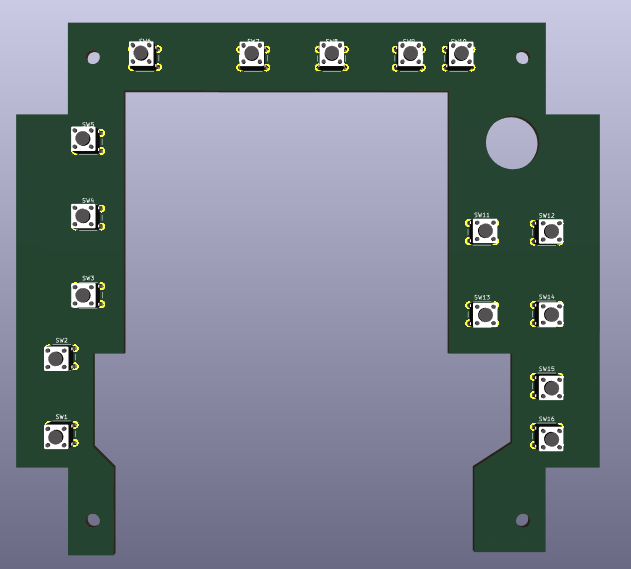
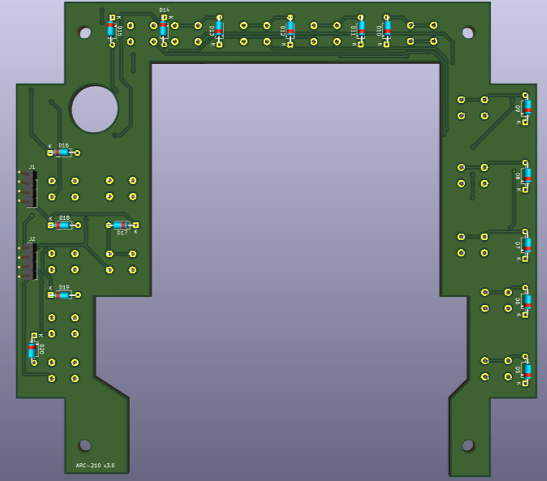
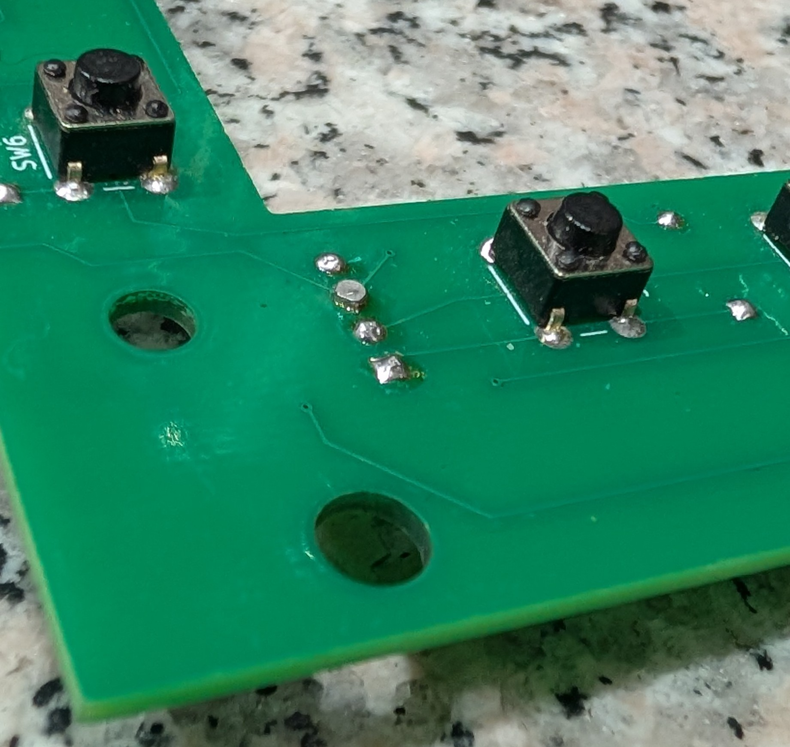

# ARC-210 Button Matrix PCB

**Last updated: October 31, 2026 at 1:45 AM MDT (America/Denver)**

**October 30, 2026 — v3.2 released:** Removed the duplicate approximately 13.38 mm Edge.Cuts circle at H3; the intended opening remains a **12.0 mm non-plated hole**. Board and schematic revisions and the silkscreen are now **3.2**. I moved H3’s reference label clear of the hole’s solder-mask opening. There are no electrical changes. Gerbers and drills were freshly exported with KiCad 10.0.7; fresh ERC/DRC checks report zero violations, zero unconnected items, and zero schematic/PCB mismatches under the saved settings. Use the [v3.2 manufacturing ZIP](Manufacturing/Button-Matrix-PCB-v3.2-Gerbers-Drill.zip) for new orders.

Current Main Board version: **1.1**.

PCB version **3.2 — SQL clearance-hole correction**. The outer outline and button positions retain the v3.1 physical-fit check; manufactured v3.2 assembly and electrical testing remain pending. KiCad 10 project.

Updated October 30, 2026. The current PCB, schematic, project settings, and project-local footprint library are included in this folder.

This is the current **unlit 16-button, 4 × 4 matrix**.

**The current Button Matrix PCB v3.2 does not support LED backlighting.** I would need to redesign the button board with LED support, use suitable light-transmitting buttons, and make the required Main Board, power, and driver changes. I may revisit this after completing the ARC-164 and ARC-186 projects; there is no finished backlit button-board design or release date yet. See [Future Thoughts](../../Docs/Future-Thoughts.md) for the lighting redesign plan.

**SQL switch replacement pending:** The SQL On/Off switch I’m currently using does not have the correct arc of movement for the panel. I’m looking for a suitable replacement. When I find one, I’ll announce it in [Project Updates](../../Docs/Project-Updates.md) and update the [parts list](../../parts/README.md).

## Download and open

Use **Code → Download ZIP** on the repository, extract it, and keep this folder together. Open `Button Matrix.kicad_pro` in KiCad 10, then open the schematic or PCB Editor. The [schematic](Button%20Matrix.kicad_sch) and [PCB layout](Button%20Matrix.kicad_pcb) are also available directly.

The design uses standard KiCad `Connector`, `Device`, `Switch`, and `Mechanical` symbols. Install KiCad’s standard libraries and keep `fp-lib-table` and `ButtonMatrix.pretty/` beside the project. The local library supplies H3’s 12 mm non-plated SQL On/Off switch pass-through footprint.

**PCB version 3.2:** The saved PCB includes placement and routing. I removed unused floating copper fills on October 27, 2026. I shortened the slightly long board edges and checked the button positions with a printed fit test. Testing an assembled manufactured board remains pending. A [Gerber and drill ZIP](Manufacturing/Button-Matrix-PCB-v3.2-Gerbers-Drill.zip) is included for manufacturing.

## Gerber and drill files

Download [Button-Matrix-PCB-v3.2-Gerbers-Drill.zip](Manufacturing/Button-Matrix-PCB-v3.2-Gerbers-Drill.zip) for a PCB manufacturer. Generated October 30, 2026 from the corrected version 3.2 PCB using KiCad 10.0.7.

The ZIP contains the seven Gerber X2 layers (front/back copper, solder mask, silkscreen, and board outline), a Gerber job file, separate metric Excellon PTH/NPTH drill files, and manufacturing notes. Both Gerbers and drills use the absolute origin without mirroring. The source specifies a two-layer, 1.6 mm board.

The exports were checked against the source: **130 plated holes and five non-plated holes**, including four 3.5 mm mounting holes and H3’s 12 mm SQL On/Off pass-through. [Individual files, drill maps, and drill report](Manufacturing/) are also available. Check the manufacturer's preview for the board outline, central opening, and drill placement before ordering. The printed fit check confirmed button alignment; manufactured-board assembly and electrical testing remain pending.

**Final v3.1 design; test fit confirmed — October 27, 2026:** I physically test-fitted the revised v3.1 board, and it fits. The buttons are in the correct locations. The board edges were slightly too long and have been shortened for version **3.1**, which preceded the v3.2 hole correction. This historical fit check applies to the unchanged outer outline and button positions; use v3.2 for new orders. The obsolete v3.0 manufacturing ZIP has been removed; Git history retains earlier revisions.

## SQL On/Off switch shaft support

The [shaft spacer v.5](../../Supporting%20STL%27s/Shaft_Spacer_v.5.stl) is **required in all installations** to support the **longer SQL On/Off switch shaft**. Fit it whether using the optional SQL On/Off PCB or wiring directly to the switch’s solder lugs. H3’s 12 mm opening in the Button Matrix PCB provides pass-through clearance for the SQL On/Off switch.

## Layout reference pictures

These front and back pictures show the earlier **v3.0** layout. The current v3.2 files retain the slightly shortened v3.1 board edges; use the current KiCad layout and manufacturing files for exact dimensions. The large opening is the SQL On/Off switch pass-through.

### Front — push-button switches

### Back — diodes and connectors

**The switches go on the front side of the PCB, facing the faceplate. The diodes and pin connectors go on the opposite (back) side.** The silkscreen markings show which side each component belongs on, so check those markings before soldering.

**Photo reminder for my next assembly:** Once the manufactured PCBs arrive and I start building, I’ll add front-and-back photos here showing the switches on the front and the diodes and pin connectors on the back, with the silkscreen markings visible.

## Trim front-side leads before mounting

After soldering the back-mounted diodes and pin headers, use **flush cutters** to trim the diode leads and pin-header pins protruding from the **front side of the PCB** so the board can sit flush behind the faceplate. Trim close to the solder joints without cutting into the joints or PCB pads, then remove the clipped pieces before mounting the board.

After trimming, I went back and added a small amount of solder to the diode holes to ensure a good connection. Keep the solder low enough for the PCB to sit flush behind the faceplate.

  

*Front of my Button Matrix PCB after trimming the diode leads and pin-header pins. Click the photo to view it full size.*

## Buttons and connectors

Use 16 SPST momentary tactile switches, **6 × 6 × 5 mm**, with four through-hole leads. See the [parts list and supplier](../../parts/README.md#current-button-switches). Confirm the purchased switches’ contact pairing and footprint before fabrication. Verify the supplied footprint against your purchased switches before fabrication.

The schematic has **two separate four-pin connectors**, rather than one eight-pin connector:

| Button Matrix connector | Main Board J2 pin | Teensy GPIO label | KiCad Teensy U1 pad |
| --- | ---: | ---: | ---: |
| J1 pin 1 — row 1 | 1 | 30 | 22 |
| J1 pin 2 — row 2 | 2 | 31 | 23 |
| J1 pin 3 — row 3 | 3 | 32 | 24 |
| J1 pin 4 — row 4 | 4 | 33 | 25 |
| J2 pin 1 — column 1 | 5 | 35 | 27 |
| J2 pin 2 — column 2 | 6 | 36 | 28 |
| J2 pin 3 — column 3 | 7 | 37 | 29 |
| J2 pin 4 — column 4 | 8 | 40 | 32 |

The connector reference J2 on this button schematic is different from J2 on the Main Board. Use the table to wire between them. The supplied PCB uses these two four-pin connectors.

**Teensy printed GPIO labels differ from KiCad pad numbers.** For example, GPIO 30 is U1 pad 22. Use the Teensy labels for firmware and wiring, and the matching symbol/footprint pad numbers when working in KiCad.

## Diodes and testing

D5–D20 are the 16 matrix diodes. Their cathodes connect to the row lines. Confirm the intended 1N4148 parts, polarity, and supplied footprints before fabrication. See the [parts documentation](../../parts/README.md).

The [combined hardware test](../../Firmware/Test%20Code/ARC210_Button_Test/) documents the working matrix GPIO assignments and button tests. A successful breadboard test does not establish that the final PCB design has been assembled or tested.

KiCad 10.0.7 checks run October 27, 2026 reported **zero ERC violations, zero DRC errors, zero unconnected items, and zero schematic/PCB parity issues** under the saved settings. After removal of the unused no-net copper fills, DRC reports **zero warnings**. The board has no ground net and does not require a ground plane. See the [ERC summary](ERC-report.txt) and [DRC report](DRC-report.json). Some check categories are disabled. Button alignment was verified with the printed fit check; electrical operation of an assembled manufactured board has not yet been tested.

## Lighting

The PC Flights panel buttons used for this build are painted and opaque, so light will not pass through them to illuminate their legends. This design has no button-lighting LEDs.

**The current Button Matrix PCB v3.2 does not support LED backlighting and would need to be redesigned.** I would need to design a new button board with LED support (Button LED PCB), use suitable light-transmitting buttons, and redesign the power and driver circuitry with the necessary Main Board changes. The current Main Board has no external lighting-power circuit. I may revisit this after completing the ARC-164 and ARC-186 projects; there is no finished design or release date. The TFT display backlight is separate from this future button-lighting option.

I may need **four-layer PCBs for both the replacement Main Board and button board**, increasing their cost. I haven’t confirmed the layer requirements or pricing; any upgrade costs are separate from the current build estimates and my US$40 bare-PCB set.

My aim for a future LED upgrade is to let builders reuse the **rotary encoders, rotary switches, socket-mounted Teensy, and faceplate**, along with other compatible parts outside the replacement Main Board and button board. I still need to confirm compatibility during the redesign. Using male headers on the Teensy and matching female sockets on the Main Board would let you move the controller to a compatible replacement board and save buying another one. See [Future Thoughts](../../Docs/Future-Thoughts.md) for the upgrade plans.

## No access to a 3D printer?

If you don’t have access to a 3D printer and that is stopping you from building my ARC-210 panel, I’ll send you **one complete 17-part ARC-210 printed set for US$3 (three US dollars), plus shipping**. I’ll print the **mounting bracket in black PETG** and the **remaining parts in gray PETG**. I’ll only collect VAT if I’m required to. If I’m not required to collect it, I won’t. I want the lack of a printer to be one less obstacle to building your SIMPIT. Even if I’m not required to collect VAT, you may still have to pay import VAT, customs duties, or carrier clearance fees in your country. I don’t control those charges, and they aren’t included in my prices.

Get in touch through [Discussions](https://github.com/dgdimick/ARC-210-DCS-Display/discussions) so we can arrange the set and shipping. See the [ARC-210 printed-parts offer](../../parts/README.md#no-access-to-a-3d-printer) for details. Shipping and any applicable VAT are not included in the US$3 price. I’ll only collect VAT if I’m required to. If I’m not required to collect it, I won’t.

## Build cost and community

See the [DIY parts purchasing estimate](../../parts/README.md#estimated-build-cost) for a build budget. Parts and fabrication are sourced independently; this is primarily a DIY project.

Need a hand? Ask in [Discussions](https://github.com/dgdimick/ARC-210-DCS-Display/discussions), share your build photos, or [introduce yourself](https://github.com/dgdimick/ARC-210-DCS-Display/discussions/1).

If you’re local to me in **New Mexico, USA**, I’d be happy to meet up and provide whatever help I can with your SIMPIT. Get in touch through [Discussions](https://github.com/dgdimick/ARC-210-DCS-Display/discussions) so we can talk about your build and arrange a time.

PCB design license: CERN-OHL-P-2.0, as specified in the [main README](../../README.md#licensing).
