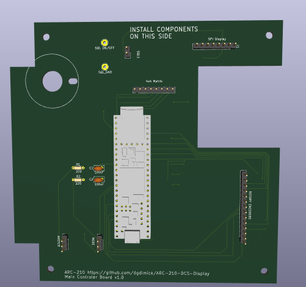

# ARC-210 Main Controller PCB draft and schematic

Updated October 28, 2026: USB-powered design with TFT VCC supplied directly from the Teensy's 3.3 V rail.

## Download and open

Download this repository using **Code → Download ZIP**, extract it, and keep this entire folder together. Open `ARC-210_Master_Board.kicad_pro` in **KiCad 10**, then open the schematic or PCB Editor.

You can also download the [schematic](ARC-210_Master_Board.kicad_sch) and [PCB draft](ARC-210_Master_Board.kicad_pcb) directly. Downloading only that file does not include the project library configuration.

This is a **PCB layout draft**, not a manufacturing release. The outline, switch mounting and anti-rotation cutouts, four 3.5 mm mounting holes, and retained component footprints are present. All 13 circuit component footprints are on B.Cu, with their bodies facing away from the faceplate. Component placement and routing are in progress; see the October 28 picture below. Final placement, routing, design checks, current verification, and physical test fit remain unfinished. No Main Board Gerber package is included.

## PCB layout — five or six boards

The panel uses **five required PCBs**: one Main Controller, one Button Matrix, one Rotary Encoder, and two multi-position Rotary Switch boards, all controlled by one Teensy 4.1. An **optional SQL On/Off switch PCB brings the total to six**; it can be omitted when wiring directly to the switch’s solder lugs. The optional SQL board uses the same Rotary Switch PCB design.

The [shaft spacer v.5](../../Supporting%20STL%27s/Shaft_Spacer_v.5.stl) is **required in all installations** to support the longer SQL On/Off switch shaft, whether or not the optional PCB is fitted.

## Signals and connectors

- **J1:** TFT connector. See the [TFT cable mapping](../../parts/README.md#pin-headers-and-mating-connectors--october-12-2026); it is not a straight-through cable.
- **J2:** separate 4 × 4 button matrix; pins 1–4 use GPIO 30, 31, 32, 33, and pins 5–8 use GPIO 35, 36, 37, 40.
- **J4:** 14-pin rotary-encoder connector; pins 13 and 14 are GND.
- **J10 pin 2:** rotary-switch signal through R1 to GPIO 14 / A0, KiCad U1 pad 36.
- **J9 pin 2:** rotary-switch signal through R2 to GPIO 15 / A1, KiCad U1 pad 37.
- **SQL1:** pin 1 is GPIO 41 / U1 pad 33; pin 2 is GND. The SQL On/Off switch PCB is optional when wiring its solder lugs directly. Dedicated **TP1 (SQL signal, GPIO 41 / U1 pad 33)** and **TP2 (GND)** solder-wire pads are now included in the Main schematic and PCB draft. The optional SQL1 header remains available; final pad placement and routing are pending.

**GPIO labels are not KiCad pad numbers.** For example, GPIO 4 is U1 pad 6, GPIO 14 is pad 36, and GPIO 15 is pad 37. Use the labels printed on the Teensy for wiring and firmware; use the matching symbol and `teensy:Teensy41` footprint when updating the PCB.

## SQL On/Off rotary switch support

Use the [shaft support spacer v.5](../../Supporting%20STL%27s/Shaft_Spacer_v.5.stl) in **all installations** to support the **longer shaft used by the SQL On/Off rotary switch**. Fit the spacer whether using the optional switch PCB or wiring directly to the switch's solder lugs.

## Power and lighting

The Teensy is powered by USB, and **TFT VCC connects directly to the Teensy's 3.3 V rail** (`TEENSY_3V3`, U1 pad 15). TFT brightness at 3.3 V has been confirmed satisfactory. The external protected 5 V input and Main Board JP1 power selector have been removed. C5 (470 µF) and C6 (0.1 µF) have been removed to match the tested direct Teensy-to-TFT wiring. C1/C2 and R1/R2 remain as the rotary-input filters. Keep total external 3.3 V consumption within PJRC's recommended 250 mA maximum; brightness confirmation is not a current measurement.

Removed from the schematic and PCB: **J3, F2, D1, D2, D3, Q2, R15, R16, R17, JP1, C5, and C6**. There is no external input jack, fuse, SCR/zener protection branch, power indicator LED, or TFT power-selector shunt in this revision. This does not affect the separate rotary-switch PCB's JP1 solder bridge.

C5 (470 µF) and C6 (0.1 µF) have been removed from the schematic, PCB, and BOM to match the tested direct TFT wiring. No additional TFT supply capacitors are fitted on this Main Board. C1/C2 and R1/R2 remain as the rotary-input filters. The TFT backlight-control signal remains connected to GPIO 4.

Future button lighting would require a separate power and driver design, suitable light-transmitting buttons, and a new Button LED PCB. The current Main Board has no external lighting-power circuit. This lighting revision is not currently planned; the other radio projects remain the priority.

## Rotary-switch test wiring

Both seven-position switches worked with their outputs connected directly to GPIO 14 and 15, without the schematic's 220 Ω series resistors or 100 nF filter capacitors. The six 1 kΩ ladder resistors on each switch board were fitted and JP1 on each switch board was open. Voltage fluctuations were visible on the TFT but did not affect the detected switch positions.

## Teensy 4.1 in the 3D Viewer

### Main PCB 3D preview

*October 28, 2026 — Main Board placement and routing in progress, viewed from the component side facing away from the faceplate.*

The current working layout includes the Teensy 4.1, TFT and control connectors, and SQL On/Off solder connections. **J9 is MODE** (GPIO 15 / A1), and **J10 is MASTER** (GPIO 14 / A0). A **26.2 mm circle on User.Drawings**, centered on the SQL shaft hole, provides a switch-body spacing guide without electrical pads. The existing shaft opening, anti-rotation slot, and mounting holes are retained.

This picture shows the working layout and may be ahead of the published KiCad files. Final placement, routing, design checks, current verification, and Main Board physical test fit remain unfinished. The Main Board is not ready for manufacture.

[Earlier angled Teensy 4.1 preview — October 27](../../images/Main-PCB-Teensy-3D.png)

The project includes [Teensy_4.1_Board.step](Libraries/3dmodels/Teensy_4.1_Board.step), already attached to **U1** in the Main PCB. Its model path is `${KIPRJMOD}/Libraries/3dmodels/Teensy_4.1_Board.step`, so it works after downloading or cloning the repository without a machine-specific path.

1. Download the repository ZIP or clone it, then extract/keep the entire Main Board project folder together.
2. Open `ARC-210_Master_Board.kicad_pro` and launch PCB Editor.
3. Open **View → 3D Viewer** (**Alt+3**).
4. Rotate to the back/underside: U1 and the other component bodies are on **B.Cu**, facing away from the faceplate.

If U1 is missing, check its **Footprint Properties → 3D Models** entry and confirm the STEP file is present at the path above. Reopen the viewer after replacing project files. The old missing assembly-model path and erroneous footprint-folder model entry have been removed.

The model was checked in bottom and angled renders. This verifies visibility and visual alignment; physical mounting/socket clearance still needs the Main Board fit check. No electrical connections were changed by attaching the model.

## Included libraries and checks

- `Libraries/symbols/teensy.kicad_sym`: Teensy symbols; accompanying license included.
- `Libraries/symbols/ARC210_Power.kicad_sym`: C106D SCR symbol.
- `Libraries/teensy.pretty/Teensy41.kicad_mod`: matching Teensy 4.1 footprint.
- `ARC210_Custom.pretty`: historical custom footprints; the removed protection parts are no longer fitted.
- `sym-lib-table` and `fp-lib-table`: project-relative library paths.

Install KiCad's standard symbol, footprint, and 3D model libraries too. The Teensy 4.1 STEP model is now included and attached to U1; see the 3D Viewer section above.

October 27, 2026 checks: [ERC](ERC-report.json) reports zero violations under the saved settings. [PCB DRC and schematic parity](DRC-report.json) report zero non-routing violations and zero schematic/PCB mismatches, with 51 unconnected items because the draft is not routed. Netlist verification confirms J1 pin 1 connects directly to `TEENSY_3V3` / U1 pad 15. Only the C5/C6 pin connections were removed; C1/C2 and all other retained connections are unchanged. Some check categories are disabled. These results do not make the draft ready for manufacture.

PCB design license: CERN-OHL-P-2.0, as specified in the [main README](../../README.md#licensing). The bundled Teensy library retains its included license.

## Build cost and community

See the [DIY parts purchasing estimate](../../parts/README.md#estimated-build-cost) to plan your budget. This is primarily a DIY project, with files and guidance to help you source parts and fabrication independently.

Questions or build photos? Join [Discussions](https://github.com/dgdimick/ARC-210-DCS-Display/discussions), or [introduce yourself in the welcome discussion](https://github.com/dgdimick/ARC-210-DCS-Display/discussions/1).

