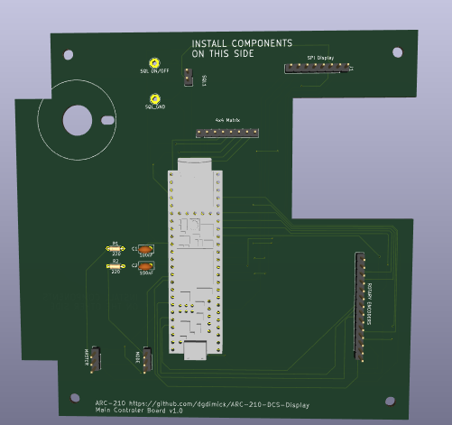

# ARC-210 Main Board v1.1 and schematic

**November 14, 2026 — Main Board v1.1 withdrawn.** I’ve withdrawn the ARC-210 Main Board v1.1 after finding that the PCB interferes with the body of the SQL On/Off switch during assembly. Please hold off on ordering this board. I’ll repost the files after I revise the layout and verify the fit.

**Last updated: November 13, 2026 at 9:41 PM MST (America/Denver)**

Updated October 29, 2026: USB-powered design with TFT VCC supplied directly from the Teensy's 3.3 V rail.

## Download and open

Download this repository using **Code → Download ZIP**, extract it, and keep this entire folder together. Open `ARC-210_Master_Board.kicad_pro` in **KiCad 10**, then open the schematic or PCB Editor.

The [v1.1 schematic](ARC-210_Master_Board.kicad_sch) is available as a reference for existing boards.

## PCB layout — five boards

The ARC-210 uses **five PCBs**: one Main Board, one Button Matrix, one Rotary Encoder board, and two Rotary Switch boards for MAIN and MOD.

The [shaft spacer v.5](../../Supporting%20STL%27s/Shaft_Spacer_v.5.stl) is **required in all installations** to support the longer SQL On/Off switch shaft.

## Signals and connectors

- **J1:** TFT connector. See the [TFT cable mapping](../../parts/README.md#pin-headers-and-mating-connectors--october-12-2026); it is not a straight-through cable.
- **J2:** separate 4 × 4 button matrix; pins 1–4 use GPIO 30, 31, 32, 33, and pins 5–8 use GPIO 35, 36, 37, 40.
- **J4:** 14-pin rotary-encoder connector; pins 13 and 14 are GND.
- **J10 (MASTER) pin 2:** rotary-switch signal through R1 to GPIO 14 / A0, KiCad U1 pad 36.
- **J9 (MODE) pin 2:** rotary-switch signal through R2 to GPIO 15 / A1, KiCad U1 pad 37.
- **J13.** Mount the C&K A12515RNZQ solder-lug switch by its shaft bushing. Solder its common lug to **Main Board J13 pad 1 (SQL_ONOFF, Teensy GPIO 41)** and the contact selected in the ON position to **J13 pad 2 (GND)**. Set the stop ring to two positions for 45° of travel.

**GPIO labels are not KiCad pad numbers.** For example, GPIO 4 is U1 pad 6, GPIO 14 is pad 36, and GPIO 15 is pad 37. Use the labels printed on the Teensy for wiring and firmware; use the matching symbol and `teensy:Teensy41` footprint when updating the PCB.

## USB cable zip-tie slots

**Added October 29, 2026:** The PCB includes two **4 × 2 mm oblong internal cutouts** below the Teensy's USB connector. Their centers align with the two Teensy pin rows, at X = 128.21 mm and 143.45 mm, Y = 163.50 mm in the KiCad board coordinates. The long direction follows the pin rows/cable direction.

The slots are intended for a small **2.5 mm zip tie** to hold the USB cable against the PCB and reduce strain on the Teensy's Micro-B connector. They are milled cutouts on **Edge.Cuts**, with no electrical pads. The existing routing and component positions are unchanged.

**Pending physical fit check:** Confirm the actual cable plug, boot, and tie fit before final assembly. Secure the cable without loading the USB connector, leave service slack, and avoid overtightening. Final cable support validation and any additional printed support remain pending. Main Board v1.1 fabrication files are published; the physical strain-relief check remains pending.

The updated DRC/parity report shows **zero violations, zero unconnected items, and zero schematic/PCB mismatches** under the saved settings.

## Required Rotary Encoder spacers

Print **six [Rotary Encoder spacers v.1](../../Supporting%20STL%27s/Rotary_Encoder_Spacer_v.1.stl)**, one for each encoder, to center the encoder threads in the faceplate holes.

## SQL On/Off rotary switch support

Use the [shaft support spacer v.5](../../Supporting%20STL%27s/Shaft_Spacer_v.5.stl) in **all installations** to support the **longer shaft used by the SQL On/Off rotary switch**.

## Channel and SQL knobs

**The 17-part set has passed test fitting at 100% scale, with Channel v4.2 separately reprinted and confirmed after the earlier complete-layout test. The combined downloads now include that replacement.** Please keep checking [Project Updates](../../Docs/Project-Updates.md) for changes.

[Channel knob v4.2](../../Supporting%20STL%27s/Channel_Knob_v.4.2.stl) · [SQL knob v1.2](../../Supporting%20STL%27s/SQL_Knob_v.1.2.stl)

**Channel v4.2 and SQL v1.2 have the same outside size and small side hole, but different shaft holes.** Print one of each at 100% scale. I’ve test-fitted both; see the [STL README](../../Supporting%20STL%27s/README.md) for the socket details and current downloads.

The SQL shaft support spacer v.5 remains required in all installations.

## Power and lighting

The Teensy is powered by USB, and **TFT VCC connects directly to the Teensy's 3.3 V rail** (`TEENSY_3V3`, U1 pad 15). I’ve tested the TFT at 3.3 V and found the brightness satisfactory. I removed the external protected 5 V input and Main Board JP1 power selector. I removed C5 (470 µF) and C6 (0.1 µF) to match the direct Teensy-to-TFT wiring I tested. C1/C2 and R1/R2 remain as the rotary-input filters. Keep total external 3.3 V consumption within PJRC's recommended 250 mA maximum; brightness confirmation is not a current measurement.

Removed from the schematic and PCB: **J3, F2, D1, D2, D3, Q2, R15, R16, R17, JP1, C5, and C6**. There is no external input jack, fuse, SCR/zener protection branch, power indicator LED, or TFT power-selector shunt in this revision. This does not affect the separate rotary-switch PCB's JP1 solder bridge.

C5 (470 µF) and C6 (0.1 µF) have been removed from the schematic, PCB, and BOM to match the tested direct TFT wiring. No additional TFT supply capacitors are fitted on this Main Board. C1/C2 and R1/R2 remain as the rotary-input filters. The TFT backlight-control signal remains connected to GPIO 4.

**The current Button Matrix PCB v3.2 has unlit buttons.** The revised Main Board includes power and dimming circuitry for future LED button backlighting. My plan is to reuse that Main Board when I release a backlit Button Matrix PCB for light-transmitting buttons. There’s no release date for the button-board upgrade.

My aim is to reuse the **rotary encoders, rotary switches, socket-mounted Teensy, faceplate, and other compatible parts outside the two replacement boards**. I still need to check compatibility during the redesign. Male Teensy headers and matching Main Board sockets would let you move the controller to a compatible replacement board. Illuminated legends would need suitable light-transmitting buttons.

## Rotary-switch test wiring

I tested both seven-position switches with their outputs connected directly to GPIO 14 and 15. They worked without the schematic's 220 Ω series resistors or 100 nF filter capacitors. The six 1 kΩ ladder resistors on each switch board were fitted and JP1 on each switch board was open. I saw voltage fluctuations on the TFT, but they did not affect the detected switch positions.

## Teensy 4.1 in the 3D Viewer

### Main PCB 3D preview

*October 28, 2026 — Main Board placement and routing in progress, viewed from the component side facing away from the faceplate.*

The current working layout includes the Teensy 4.1, TFT and control connectors, and SQL On/Off solder connections. **J9 is MODE** (GPIO 15 / A1), and **J10 is MASTER** (GPIO 14 / A0). A **26.2 mm circle**, centered on the SQL shaft hole, provides a switch-body spacing guide without electrical pads. The earlier board-edge silkscreen clipping warning is resolved in the corrected upload. The existing shaft opening, anti-rotation slot, and mounting holes are retained.

The current saved PCB and schematic shown by this layout-progress update are now uploaded to this folder. The v1.1 design checks pass under the saved settings. I’ve checked the physical fit of Main Board v1.1; I still need to complete verification. Main Board v1.1 design and fabrication files are now published; physical fit is confirmed and manufactured-board validation is still to come.

[Earlier angled Teensy 4.1 preview — October 27](../../images/Main-PCB-Teensy-3D.png)

The project includes [Teensy_4.1_Board.step](Libraries/3dmodels/Teensy_4.1_Board.step), already attached to **U1** in the Main PCB. Its model path is `${KIPRJMOD}/Libraries/3dmodels/Teensy_4.1_Board.step`, so it works after downloading or cloning the repository without a machine-specific path.

1. Download the repository ZIP or clone it, then extract/keep the entire Main Board project folder together.
2. Open `ARC-210_Master_Board.kicad_pro` and launch PCB Editor.
3. Open **View → 3D Viewer** (**Alt+3**).
4. Rotate to the back/underside: U1 and the other component bodies are on **B.Cu**, facing away from the faceplate.

If U1 is missing, check its **Footprint Properties → 3D Models** entry and confirm the STEP file is present at the path above. Reopen the viewer after replacing project files. The old missing assembly-model path and erroneous footprint-folder model entry have been removed.

I checked the model in bottom and angled renders. This verifies visibility and visual alignment; I’ve now checked the physical fit of Main Board v1.1. Final socket height and component clearances should still be checked during assembly. No electrical connections were changed by attaching the model.

## Included libraries and checks

- `Libraries/symbols/teensy.kicad_sym`: Teensy symbols; accompanying license included.
- `Libraries/symbols/ARC210_Power.kicad_sym`: C106D SCR symbol.
- `Libraries/teensy.pretty/Teensy41.kicad_mod`: matching Teensy 4.1 footprint.
- `ARC210_Custom.pretty`: historical custom footprints; the removed protection parts are no longer fitted.
- `sym-lib-table` and `fp-lib-table`: project-relative library paths.

Install KiCad's standard symbol, footprint, and 3D model libraries too. The Teensy 4.1 STEP model is now included and attached to U1; see the 3D Viewer section above.

October 29, 2026 checks after matching J4 and TP1 values: [ERC](ERC-report.json) reports **zero violations**. [PCB DRC and schematic parity](DRC-report.json) report **zero DRC violations, zero unconnected items, and zero schematic/PCB mismatches** under the saved settings. J4 is labelled **ROTARY ENCODERS** and TP1 **SQL ON/OFF** in both the schematic and PCB. The silkscreen clipping warning is also resolved. Some check categories are disabled. Physical fit is confirmed for Main Board v1.1. Final routing review and current verification remain pending; the v1.1 fabrication files are published, with board fit confirmed and assembled-board validation still pending.

PCB design license: CERN-OHL-P-2.0, as specified in the [main README](../../README.md#licensing). The bundled Teensy library retains its included license.

## Build cost and community

See the [DIY parts purchasing estimate](../../parts/README.md#estimated-build-cost) to plan your budget. This is primarily a DIY project, with files and guidance to help you source parts and fabrication independently.

Questions or build photos? Join [Discussions](https://github.com/dgdimick/ARC-210-DCS-Display/discussions), or [introduce yourself in the welcome discussion](https://github.com/dgdimick/ARC-210-DCS-Display/discussions/1).

## Standalone manufacturing files

These files are a **draft fabrication export**, not a validated production release. Main Board v1.1 physical fit is confirmed; final routing review, current verification, assembly and electrical testing remain pending.

## Main Board version 1.1
