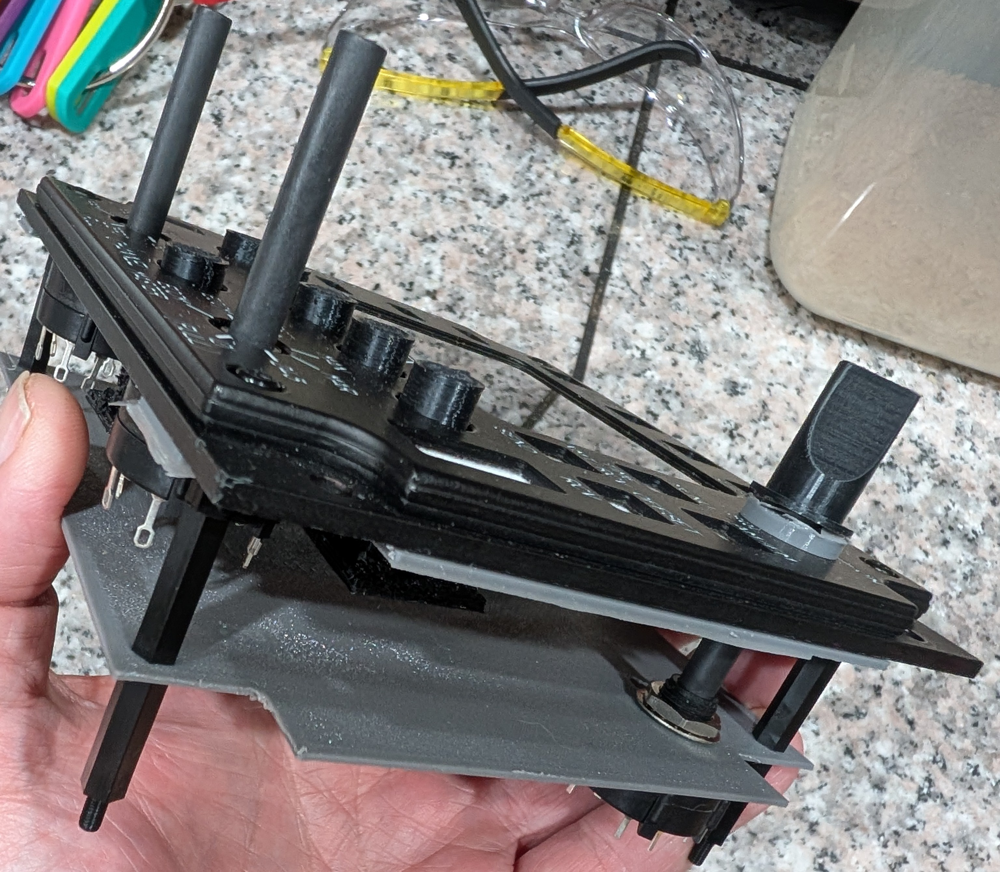

[Back to the main project README](../README.md)

# PCB layout — five boards

**Last updated: October 30, 2026 at 9:15 PM MDT (America/Denver)**

  

ARC-210 PCB layout mockup showing board spacing, control placement, and clearance behind the PC Flights faceplate. Mechanical fit check before final PCB design.

The ARC-210 uses **five PCBs**: one Main Board, one Button Matrix, one Rotary Encoder board, and two Rotary Switch boards for MAIN and MOD.

The [shaft spacer v.5](../Supporting%20STL%27s/Shaft_Spacer_v.5.stl) is **required in all installations** to support the **longer SQL On/Off switch shaft**.

All boards are controlled by one Teensy 4.1:

- **Master PCB:** carries the USB-powered Teensy, 3.3 V TFT supply, display and control connections.
- **Button PCB:** carries the push-button switches behind the faceplate and connects to the master PCB.
- **Rotary Encoder PCB:** carries the rotary encoders and connects to the master PCB.
- **Rotary Switch PCBs:** one board each for the seven-position MAIN and MOD switches.

The two rotary switch PCBs use the same design. Fit six 1 kΩ resistors on each and leave JP1 open.

The button, rotary encoder, and rotary switch PCBs do not require additional microcontrollers. The Button Matrix PCB v3.2, Rotary Encoder PCB v1.4, and Rotary Switch PCB v2.0 are final designs. The revised Main Board manufacturing files are pending the SQL and USB slot fit test.

Mount the C&K A12515RNZQ solder-lug switch by its shaft bushing. Solder its common lug to **Main Board J13 pad 1 (SQL_ONOFF, Teensy GPIO 41)** and the contact selected in the ON position to **J13 pad 2 (GND)**. Set the stop ring to two positions for 45° of travel.

[PCB files, manufacturing downloads, and status](README.md)
