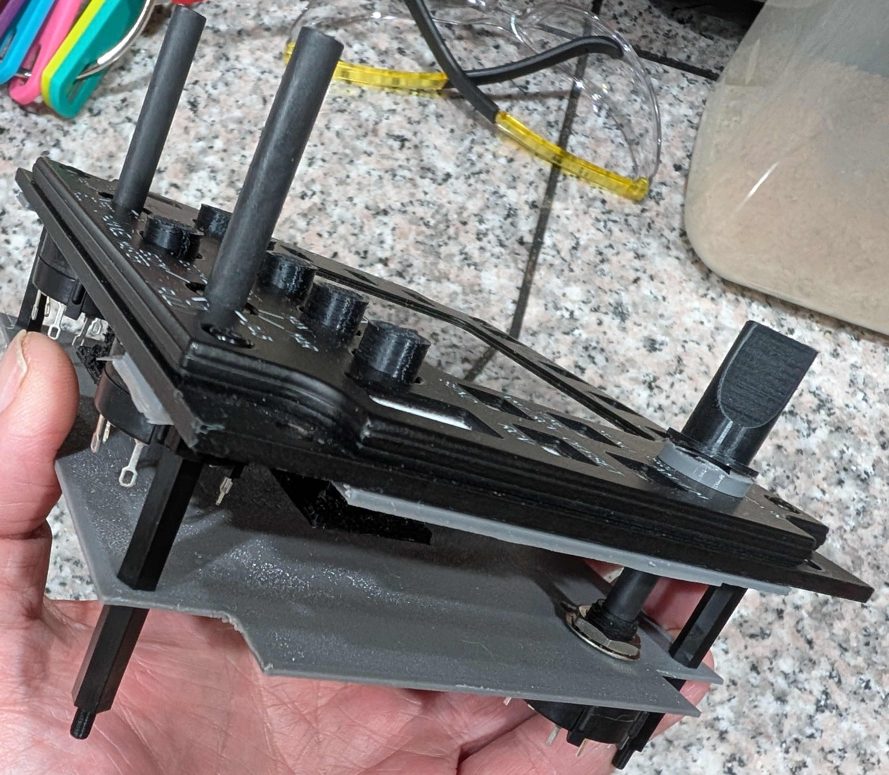

[Back to the main project README](../README.md)

# PCB layout — five or six boards

  

ARC-210 PCB layout mockup showing board spacing, control placement, and clearance behind the PC Flights faceplate. Mechanical fit check before final PCB design.

The panel uses five required PCBs: one Main Board, one Button Matrix, one Rotary Encoder, and two multi-position Rotary Switch boards. An optional SQL On/Off switch PCB brings the total to six; it can be omitted when wiring directly to the switch’s solder lugs.

The [shaft spacer v.5](../Supporting%20STL%27s/Shaft_Spacer_v.5.stl) is **required in all installations** to support the **longer SQL On/Off switch shaft**, whether or not the optional PCB is fitted.

All boards are controlled by one Teensy 4.1:

- **Master PCB:** carries the USB-powered Teensy, 3.3 V TFT supply, display and control connections.
- **Button PCB:** carries the push-button switches behind the faceplate and connects to the master PCB.
- **Rotary Encoder PCB:** carries the rotary encoders and connects to the master PCB.
- **Rotary Switch PCBs:** the two seven-position switches each use a PCB. A third PCB can be used for the SQL On/Off switch for cleaner wiring and wire support, or omitted when wiring the solder-lug switch directly.

The three Rotary Switch PCBs use the same design and are interchangeable; the SQL On/Off board is optional. For the **SQL On/Off rotary switch PCB**, install **no resistors** (omit R1–R6) and bridge the small **JP1 solder pad**, marked **ON/OFF**, with solder. For the other two seven-position rotary-switch PCBs, install the six resistors and leave JP1 open.

The button, rotary encoder, and rotary switch PCBs do not require additional microcontrollers. The Button Matrix PCB v3.2, Rotary Encoder PCB v1.4, and Rotary Switch PCB v2.0 are final designs. Main Board v1.1 completes the PCB designs, and its standalone manufacturing files are published. Manufactured-board fit and electrical testing are next.

**SQL On/Off direct-wiring option:** The SQL On/Off PCB is optional when using the solder-lug switch. You can solder wires directly to the switch’s common lug and the selected contact lug, then connect them to the Main Board’s SQL signal (GPIO 41) and GND connections. Select the contact to match the panel’s SQL On/Off positions and configure GPIO 41 with a pull-up. No resistor ladder is needed for this option. Dedicated **TP1 (SQL signal, GPIO 41 / U1 pad 33)** and **TP2 (GND)** solder-wire pads are now included in the Main Board schematic and PCB draft. The optional SQL1 header remains available. The pads are placed and routed in the current draft; I’ve checked the physical fit of Main Board v1.1; I still need to check the assembled board.

[PCB files, manufacturing downloads, and status](README.md)
