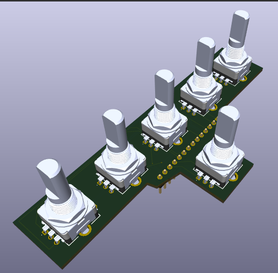

# ARC-210 Rotary Encoder PCB

Version **1.4 — Final PCB design**, updated October 12, 2026. KiCad 10 project.

Version **1.4 is the final PCB design and has been physically test-fitted**, confirmed October 12, 2026.

Version 1.4 publishes the latest saved PCB layout and project settings, including the updated board outline and v1.4 silkscreen label. The earlier version 1.3 check results below are historical; electrical and PCB design checks have not been rerun for this upload.

For version 1.3, I checked this six-encoder PCB against its schematic. The electrical check reported zero errors and warnings; the PCB check reported zero violations, zero unconnected pads and zero schematic parity issues under the project's saved check settings. Courtyard and certain footprint checks are disabled in those settings.

I printed the rotary-encoder STL and confirmed that it fits, and all six encoders worked together in the combined hardware test. Testing an assembled, manufactured PCB is still on my list. The check results above explain what has been verified so far.

## Open the project

Download this folder and keep its contents together. Open `Rotary Encoders.kicad_pro` in KiCad 10. The custom symbol and footprint libraries are included and use project-relative paths. Install KiCad's standard symbol and footprint libraries as well.

## Optional encoder 3D model

Download [LIB_PEC11H-4220F-S0024.zip](LIB_PEC11H-4220F-S0024.zip), the original supplier library archive. Extract `PEC11H-4220F-S0024/3D/PEC11H-4220F-S0024.stp` and place the STP file beside `Rotary Encoders.kicad_pcb`.

In KiCad PCB Editor, open each encoder's Footprint Properties → 3D Models and use `${KIPRJMOD}/PEC11H-4220F-S0024.stp`. Remove or disable the older `PEC11R-4220F-S0024.stp` substitute so two models are not displayed together. Use offset X = 2.5 mm, Y = 7.49 mm, Z = 0.2300 mm; scale = 1 on all axes; rotation X = 90°, Y = -180°, Z = -180°. Check alignment in the 3D Viewer. Make the same model change in the library footprint if you want it applied to future placements.

The STEP model is optional; missing 3D models do not prevent opening or manufacturing the board.

## Parts and connections

- Six Bourns PEC11H-4220F-S0024 rotary encoders.
- J1: 14-pin header; use the assigned footprint to choose the connector.
- Both J1 pins 13 and 14 connect to GND, as do encoder common contacts and metal mounting tabs.
- The encoders' push-switch contacts S1 and S2 are deliberately unused and marked no-connect.

| J1 pin | Connection |
| --- | --- |
| 1 | SW1 B |
| 2 | SW1 A |
| 3 | SW2 A |
| 4 | SW2 B |
| 5 | SW3 B |
| 6 | SW3 A |
| 7 | SW4 A |
| 8 | SW4 B |
| 9 | SW5 B |
| 10 | SW5 A |
| 11 | SW6 B |
| 12 | SW6 A |
| 13 | GND (encoder commons and mounting tabs) |
| 14 | GND (encoder commons and mounting tabs) |

The tested GPIO pairs, identified by the labels printed on the Teensy, are: SW1 = 16/17, SW2 = 28/29, SW3 = 20/21, SW4 = 22/23, SW5 = 24/25 and SW6 = 26/27. Ensure all encoder commons share Teensy GND. The final [combined hardware test HEX](../../Firmware/Test%20Code/ARC210_Final_Hardware_Test_Teensy41.hex) provides counts and A/B diagnostics.

## Manufacturing files

This upload contains the editable project. Export copper, silkscreen, solder-mask and Edge.Cuts Gerbers plus drill files from KiCad for your PCB manufacturer. Review the manufacturer's preview before ordering.

PCB licensing: CERN-OHL-P-2.0, as specified in the repository.

## Teensy GPIO labels and KiCad pin numbers

**Use the numbers printed on the Teensy (or the matching GPIO labels on your breakout adapter) when following the firmware and wiring instructions.** KiCad uses a separate set of pin/pad numbers for the Teensy symbol and its matching `teensy:Teensy41` footprint. These include power and ground connections, so they are not the same as GPIO numbers.

| Teensy printed label / firmware GPIO | KiCad U1 pin / footprint pad |
| --- | ---: |
| GND (one of several ground connections) | 1 |
| 0 | 2 |
| 4 — TFT backlight | 6 |
| 14 / A0 — rotary-switch input | 36 |
| 15 / A1 — rotary-switch input | 37 |

For example, connect a rotary-switch signal to the Teensy connection marked **14/A0**, which is **KiCad pad 36**—not pad 14. In KiCad, read the symbol’s pin name and net label to identify the signal. Updating the PCB from the schematic with the matching symbol and footprint maps the connections to the correct physical locations. This pad mapping applies to the Teensy library supplied with this project; other libraries may use different numbering.

## Estimated build cost

Thinking about building one? The [DIY parts purchasing estimate](../../parts/README.md#estimated-build-cost) gives you an idea of the budget, including the faceplate, display, electronics, and PCB fabrication. You’ll source the parts yourself, and I’m sharing the files and guidance to help along the way.

## Questions and community builds

**Building your own panel, or just looking around?** [Introduce yourself in the welcome discussion](https://github.com/dgdimick/ARC-210-DCS-Display/discussions/1) and tell us what you fly. Questions, ideas, and progress photos are all welcome—even if you’re only getting started.

Visit [GitHub Discussions](https://github.com/dgdimick/ARC-210-DCS-Display/discussions) to ask questions, share ideas, and post photos of your builds.
