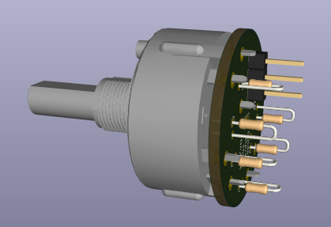

# ARC-210 Rotary Switch PCB — Version 2.0 — Final PCB design

Updated October 12, 2026.

Version **2.0 is the final PCB design and has been physically test-fitted**, confirmed October 12, 2026.

Version 2.0 uses a 27.99 mm circular PCB outline, approximately 1 mm outside the switch body, with the resistors and connector repositioned inside the outline. The PCB silkscreen and board revision identify version 2.0. This KiCad 10 project replaces the previously published board. Switch terminal 1 is used for position 1. The resistor ladder uses **six resistors (R1–R6)** to provide seven switch-position voltages. The switch contacts used are 1, 2, 4, 5, 7, 8 and 10; terminal 11 is unused. A1 is the common contact and analog output.

Open `Rotary Switches.kicad_pro`. The project includes its custom symbol and A12505RNCQ footprint, with relative library paths so they work after downloading.

- SW1: C&K A12505RNCQ, PCB terminals, 12.7 mm shaft, 45° indexing.
- R1–R6: **six resistors**, each 1 kΩ, 1%, 1/8 W.
- J1: pin 1 = 3.3 V; pin 2 = analog output; pin 3 = GND.

The master schematic shows a 220 Ω series resistor and 100 nF capacitor near each Teensy rotary-switch input.

**Tested wiring:** Both seven-position rotary switches were tested and worked with each switch PCB’s J1 pin 2 connected directly to its Teensy input (GPIO 14 or GPIO 15), without the 220 Ω series resistor or 100 nF input-filter capacitor. The six 1 kΩ resistor-ladder resistors on each switch PCB were still fitted, and JP1 was left open. Some fluctuation was visible in the voltage readings on the TFT, but it did not affect the detected switch positions. This records the successful breadboard setup; the input-filter components shown in the master schematic were not part of that test.

## SQL On/Off option added in version 1.2

I modified the PCB so it can also be used with the SQL On/Off switch. **JP1**, marked **ON/OFF** on the back of the PCB near R2, is an open solder jumper between GND and the R1–R2 junction: R2 pad 1, also connected to switch terminal 2.

- **SQL On/Off:** omit all six resistors R1–R6 and bridge JP1 with solder. Connect J1 pin 2 (switch common A1) to a Teensy input configured with a pull-up, and J1 pin 3 to GND. Selecting terminal 2 pulls the input LOW; an ungrounded contact reads HIGH. J1 pin 1 is not needed for this configuration. Set the switch travel and contact selection to match the panel markings.
- **Resistor ladder:** fit all six resistors R1–R6 and leave JP1 open. Use the three J1 connections listed above.

The solder-lug A12515RNZQ still requires mechanical support and wires to the corresponding PCB connections; it does not fit the PCB-pin footprint directly.

Validation for version 2.0: KiCad PCB DRC, with zones refilled, reported zero non-excluded violations and zero unconnected pads under the saved project settings. The project contains 15 specific PTH-inside-switch-courtyard exclusions for the rear-side resistors and connector; their lead and solder-joint clearance to the switch body still requires physical verification. Several other check categories are disabled in the project. Fresh electrical schematic and PCB checks, including schematic parity, were run October 27, 2026; see the manufacturing files section. I’ve confirmed the mechanical fit. Testing the electrical operation of an assembled, manufactured board is still on my list; the check results above describe what has been verified so far.

**SQL On/Off direct-wiring option:** The SQL On/Off PCB is optional when using the solder-lug switch. You can solder wires directly to the switch’s common lug and the selected contact lug, then connect them to the Master board’s SQL signal (GPIO 41) and GND connections. Select the contact to match the panel’s SQL On/Off positions and configure GPIO 41 with a pull-up. No resistor ladder is needed for this option. Dedicated, labelled SQL signal and GND solder pads are planned for the Master PCB so these wires can be soldered directly to it instead of using the switch PCB and cable headers; these pads have not yet been added to the PCB design.

## Manufacturing files

Download [Rotary-Switch-PCB-v2.0-Gerbers-Drill.zip](Manufacturing/Rotary-Switch-PCB-v2.0-Gerbers-Drill.zip) for PCB fabrication. Generated October 27, 2026 from the published version **2.0** PCB using KiCad 10.0.7. [Individual Gerbers, drill files, drill maps, and check reports](Manufacturing/) are also included.

The ZIP contains seven Gerber X2 layers (front/back copper, solder mask, silkscreen, and Edge.Cuts), a Gerber job file, separate metric Excellon PTH/NPTH drill files, a drill report, and manufacturing notes. Both Gerbers and drills use the absolute origin without mirroring. The source specifies a two-layer, 1.6 mm board. Verified drill totals: **24 plated holes and zero non-plated holes**; the empty NPTH file is included intentionally.

Fresh checks reported **zero ERC violations, zero non-excluded DRC violations, zero unconnected items, and zero schematic/PCB parity issues** under the saved settings. Existing disabled checks and the 15 PTH-inside-switch-courtyard exclusions remain in effect. Review the manufacturer's preview before ordering. Testing an assembled, manufactured PCB remains pending.

## Optional switch 3D model

Download [LIB_A12505RNCQ.zip](LIB_A12505RNCQ.zip), the supplier archive for the actual **A12505RNCQ through-hole PCB-terminal switch**. Extract `A12505RNCQ/3D/A12505RNCQ.stp` and place the STP file beside `Rotary Switches.kicad_pcb`.

The board and library footprint reference `${KIPRJMOD}/A12505RNCQ.stp`. Reopen or reload the board's 3D Viewer after extraction. The board currently retains offset X = -10.5 mm, Y = 3 mm, Z = 7.5 mm, scale = 1 on all axes, and rotation X = -90°, Y = 0°, Z = 0°. These transforms were carried over from the prior model and have not been visually verified with the replacement. The reusable library footprint retains its own zero offsets and rotations; adjust those when using it for new placements.

This correct model replaces the earlier A12515RNZQ solder-lug substitute. The older ZIP is retained only as a historical optional download; use **LIB_A12505RNCQ.zip** for this PCB. No pads or electrical connections were changed by correcting the model reference.

PCB design licensing: CERN-OHL-P-2.0, as specified in the repository.

## Teensy GPIO labels and KiCad pin numbers

**Use the numbers printed on the Teensy (or the matching GPIO labels on your breakout adapter) when following the firmware and wiring instructions.** KiCad uses a separate set of pin/pad numbers for the Teensy symbol and its matching `teensy:Teensy41` footprint. These include power and ground connections, so they are not the same as GPIO numbers.

| Teensy printed label / firmware GPIO | KiCad U1 pin / footprint pad |
| --- | ---: |
| GND (one of several ground connections) | 1 |
| 0 | 2 |
| 4 — TFT backlight | 6 |
| 14 / A0 — rotary-switch input | 36 |
| 15 / A1 — rotary-switch input | 37 |

For example, connect a rotary-switch signal to the Teensy connection marked **14/A0**, which is **KiCad pad 36**—not pad 14. In KiCad, read the symbol’s pin name and net label to identify the signal. Updating the PCB from the schematic with the matching symbol and footprint maps the connections to the correct physical locations. This pad mapping applies to the Teensy library supplied with this project; other libraries may use different numbering.

## Estimated build cost

Thinking about building one? The [DIY parts purchasing estimate](../../parts/README.md#estimated-build-cost) gives you an idea of the budget, including the faceplate, display, electronics, and PCB fabrication. You’ll source the parts yourself, and I’m sharing the files and guidance to help along the way.

## Questions and community builds

**Building your own panel, or just looking around?** [Introduce yourself in the welcome discussion](https://github.com/dgdimick/ARC-210-DCS-Display/discussions/1) and tell us what you fly. Questions, ideas, and progress photos are all welcome—even if you’re only getting started.

Visit [GitHub Discussions](https://github.com/dgdimick/ARC-210-DCS-Display/discussions) to ask questions, share ideas, and post photos of your builds.
