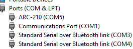

# ARC-210 Radio Control Panel for DCS A-10C II using a 3.5" SPI TFT display and DCS-BIOS — November 12, 2026

**Last updated: November 12, 2026 at 9:18 PM MST (America/Denver)**

I’m building a working ARC-210 radio panel for the DCS A-10C II using a Teensy 4.1, a 3.5-inch ILI9488 TFT display, custom PCBs, and 3D-printed parts, with DCS-BIOS for live radio data and cockpit control. I’m sharing the files and what I learn along the way so you can build your own.

I spend about **8 hours a day on my SIMPIT projects**, including working on the code, PCB design, assembly, and test fitting.

**Frequency controls:** I use **rotary encoders** for the frequency controls in this build, rather than the **ten-position rotary switches used in the real ARC-210**. **For Version 2, I plan to replace those encoders with rotary switches and two new frequency-control PCBs, while trying to reuse the existing Main Board.** See [Future thoughts and plans](Docs/Future-Thoughts.md) for the planned redesign; there is no release date yet.

## [Assembly Instructions](Docs/Build%20Guide/README.md)

## Current testing status

**The panel is now working connected to DCS.** [Watch the demonstration video](https://drive.google.com/file/d/1jLG8JLaTQ1RpAE6FKkDZAUxiwgUSQEKu/view?usp=drivesdk). The manufactured PCBs have arrived. The assembled Rotary Switch PCBs v2.0 passed both fit and functional testing. Assembly and testing continue on the rest of the panel.

**Assembly testing:** Use the [Final Hardware Test](Firmware/Test%20Code/ARC210_Button_Test/README.md). The individual TFT, button, encoder, and switch tests are optional troubleshooting tools; you don’t need to run them during normal assembly.

**What to expect before radio data arrives:**

- **v0.1.3 Diagnostic HEX:** The display stays on the splash screen while waiting for radio data. This is expected and does not mean the Teensy has frozen.
- **v0.1.2 Preview HEX:** The display stays blank until DCS-BIOS sends powered-radio data.

<p align="center">
  
</p>

[See the official DCS website](https://www.digitalcombatsimulator.com/en/)

> **Note:** This repository is now included in the [A-10-Sim repository](https://github.com/dgdimick/A-10-Sim).

## Features

[View the features](Docs/Features.md) for the hardware capabilities and planned firmware support.

## Items that need to be completed

**Last updated: November 10, 2026 at 8:15 PM MST (America/Denver)**

[View the remaining work](Docs/Remaining-Work.md) for the testing, documentation, and design tasks still to complete.

**SQL On/Off:** I use the **C&K A12515RNZQ solder-lug rotary switch**, with its stop ring set to **two positions for 45° total travel**. Align the knob with the panel’s ON/OFF markings. See the [parts list](parts/README.md) for shaft-length and mounting details.

## Tools needed

[View the tools needed](Docs/Tools-Needed.md) to build and program the panel.

## Future thoughts and plans

**Future upgrades:** It may be as long as **two years** before I return to this project with upgrades or a new version. Please treat future-version ideas as long-term plans, with no promised release date.

[View Future thoughts and plans](Docs/Future-Thoughts.md) for possible redesigns, lighting, and support for other aircraft.

**The current Button Matrix PCB v3.2 does not support LED backlighting.** My Version 2 plan requires **four new PCBs: one Button Matrix board with LED support, two frequency rotary-switch boards, and one power/dimming board for external regulated 5 V lighting power and control**. The existing Main Board has enough suitable J4 connections for five rotary-switch resistor ladders and two backlight PWM controls; the proposed pin assignment is in [Future Thoughts](Docs/Future-Thoughts.md#proposed-reuse-of-the-existing-main-board). Reusing it still requires new control and lighting boards, updated wiring and firmware, and assembly testing. **Version 2 is a long way off, so please don't wait for it if you want to build the ARC-210.** I have no finished redesign, confirmed upgrade price, or release date. See [Future Thoughts](Docs/Future-Thoughts.md) for the details.

## Project updates

**Last updated: November 12, 2026 at 9:10 PM MST (America/Denver)**

**November 12, 2026 at 9:10 PM MST — Rotary Switch PCBs passed assembly testing**

I assembled the Rotary Switch PCBs v2.0 and confirmed that they fit and work as intended. [Rotary Switch PCB instructions](PCBs/Rotary%20Switches/README.md).

[Read all project updates](Docs/Project-Updates.md) for the full dated development history.

<a id="buy-a-complete-set-of-bare-pcbs"></a>

## Bare PCB offer

I can provide **bare PCBs only**, not a kit of electronic components or an assembled panel. See my [ARC-210 bare PCB offer](Docs/ARC-210-Parts-Offers.md#bare-pcb-set) for the boards included, availability, shipping, and fees. My bare PCB offer covers the ARC-210. I’ll offer printing help for the ARC-164 and ARC-186 once their printed parts are finalized. I’m happy to provide a free printed set whether you get your PCBs from me or elsewhere. Just cover shipping.

## No access to a 3D printer?

I offer separate 3D-printing help for builders who can’t build the panel because they don’t have access to a 3D printer. This supplies printed plastic only, not electronic components or a complete kit; buy the other components separately. The complete set of 3D-printed parts is free on request. Just cover shipping. See [ARC-210 3D-printing help](Docs/ARC-210-Parts-Offers.md#printed-parts) for materials, colors, availability, shipping, VAT, and import charges.

## My SIMPIT and test computer

[View my SIMPIT and test computer](Docs/My-SIMPIT-and-Test-Computer.md) for my computer configuration, monitors, and current USB setup.

## USB connections and powered hubs

[Read about the USB connection plan and purchased powered hubs](Docs/USB-Connections-and-Powered-Hubs.md) for why I am using USB instead of RS-485.

I also own three other SIMPIT panels that use USB. I have used them for over **1,000 hours in the past year without any issues**.

I plan to use this [Veeloon Micro-USB male to USB-C female adapter cable](https://www.amazon.com/dp/B0G5YZJLVZ?th=1) with the Teensy 4.1 to provide an accessible USB-C connection. The listing specifies a **0.6 ft (about 183 mm)** cable and **480 Mbps data transfer**. **On my ARC-210, I used this adapter to control the panel through DCSBridge and successfully program the Teensy.** I still need to test it in live DCS and verify that it reconnects reliably after unplugging it.


### ARC-210 USB name in Windows

[Download the ARC-210 USB name test HEX](Firmware/Master%20Hex%20Files/ARC210_A-10C2_USB-Name_Test.hex) and flash it with Teensy Loader. I verified the USB name on Windows. DCS-BIOS communication with this test build is still pending.

The v0.1.6 Control Test for Teensy 4.1 adds the **ARC-210** USB product name to the v0.1.5 control firmware. It compiled successfully and is available for panel testing. [Download the v0.1.6 Control Test HEX](Firmware/Master%20Hex%20Files/ARC210_A-10C2_v0.1.6_Control_Test_Teensy41.hex).

I verified that the ARC-210 USB name test HEX reports **ARC-210** as its USB product name. In Device Manager, open **Ports (COM & LPT)**, right-click the panel's COM port, and select **Properties → Details → Bus reported device description** to see it.

The registry change below is optional. Without it, Device Manager will typically list the panel as **USB Serial Device (COM5)** under **Ports (COM & LPT)**, using whichever COM number Windows assigns. With the v0.1.6 HEX loaded, **Properties → Details → Bus reported device description** will show **ARC-210**. The registry change makes the Ports list show **ARC-210 (COM5)**. Teensy programming and DCS-BIOS communication work with either display name.

If I move the panel to another computer, Windows may assign it a different COM number. Select the new port in TekConnect. With firmware that reports **ARC-210**, the USB product name stays on the Teensy, and its hardware serial number normally stays the same. The custom Device Manager label is saved on each Windows computer, so renaming the port again is **optional**. The panel can be programmed and used with DCS-BIOS using the default Windows label.

I set the Windows display name to **ARC-210 (COM5)** on my PC. To do the same, open **Windows PowerShell** with **Run as administrator** and run the commands below. If your panel is on a different port, change `COM5` in the first line. The commands check that the connected device reports **ARC-210** before renaming it.

```powershell
$port = 'COM5'
$devices = @(Get-PnpDevice -PresentOnly -Class Ports -ErrorAction Stop |
    Where-Object {
        $_.FriendlyName -like "*($port)" -and
        $_.InstanceId -like 'USB\VID_16C0*'
    })
if ($devices.Count -ne 1) { throw "Expected one Teensy on $port." }

$device = $devices[0]
$product = Get-PnpDeviceProperty -InstanceId $device.InstanceId `
    -KeyName DEVPKEY_Device_BusReportedDeviceDesc -ErrorAction Stop
if ($product.Data -ne 'ARC-210') { throw "$port does not report ARC-210." }

$key = 'HKLM:\SYSTEM\CurrentControlSet\Enum\' + $device.InstanceId
Set-ItemProperty -LiteralPath $key -Name FriendlyName -Value "ARC-210 ($port)" -ErrorAction Stop
Get-PnpDevice -InstanceId $device.InstanceId | Select-Object FriendlyName, Status
```

Reopen Device Manager if it still shows the old label. The display name applies to that device instance on the Windows PC where you ran the commands.



## DCS-BIOS

[My step-by-step setup guide](Docs/DCS-BIOS.md) covers installation, file changes, and TekConnect—the app I use to manage my connections.

- [Patched A-10C.lua](https://raw.githubusercontent.com/dgdimick/ARC-210-DCS-Display/master/Docs/DCS-BIOS/A-10C.lua) — ARC-210 changes included; for **DCS-BIOS v0.11.8**.
- [DCS-BIOS-only Export.lua](https://raw.githubusercontent.com/dgdimick/ARC-210-DCS-Display/master/Docs/DCS-BIOS/DCS-BIOS-only/Export.lua) — for setups without WWT or SRS.

Follow the guide before replacing files.

## [Estimated total build cost](parts/README.md#estimated-total-build-cost)

## [Why I used a Teensy](Docs/Why-Teensy.md)

## Firmware and hardware information

[Firmware and hardware information](Docs/Firmware-and-Hardware-Information.md) for wiring, power, PCB layout, parts, printable files, software, firmware loading, and testing guides.

## Project progress and beta testing

[View project progress and beta testing](Docs/Project-Progress-and-Beta-Testing.md) for the progress video and information on helping test the panel.

## [Sharing code and improvements](Firmware/README.md)

## Questions and community builds

If you’d like to build an ARC-210 but aren’t able to assemble it yourself, get in touch through [Discussions](https://github.com/dgdimick/ARC-210-DCS-Display/discussions). I’d be happy to talk about your situation and see how I can help.

**Planning a build, already working on one, or just looking around?** [Introduce yourself in the welcome discussion](https://github.com/dgdimick/ARC-210-DCS-Display/discussions/1) and tell me which panel interests you and what you fly. Questions, ideas, and progress photos are welcome—even if you haven’t started yet.

I’m sharing the files and build notes to help you make your own panel, with parts available from the linked suppliers. If you get stuck, ask in [GitHub Discussions](https://github.com/dgdimick/ARC-210-DCS-Display/discussions)—I’m happy to help where I can.

If you’re local to me in **New Mexico, USA**, I’d be happy to meet up and provide whatever help I can with your SIMPIT. Get in touch through [Discussions](https://github.com/dgdimick/ARC-210-DCS-Display/discussions) so we can talk about your build and arrange a time.

I welcome bug reports from anyone using the project—**even tiny bugs are worth reporting**. If something doesn’t work as expected, please let me know in the [Bugs discussion section](https://github.com/dgdimick/ARC-210-DCS-Display/discussions/categories/bugs). Tell me which firmware version and board revision you’re using, if applicable, what you did, what you expected, and what happened. Reports about the build instructions are welcome too. Your reports help me improve the project for everyone.

<a id="related-radio-project"></a>

## Related radio projects

I’m finishing the A-10C II ARC-210 first, then the ARC-164 and ARC-186, before returning to additional aircraft support. [My development priorities](Docs/Related-Radio-Projects.md) may change based on feedback and interest.

I’m developing [C-130J ARC-210 support](Docs/C-130J-Support.md) here in the main project. The same ARC-210 hardware should work with both the **A-10C II and C-130J**, through a shared code base with automatic aircraft selection and aircraft-specific DCS-BIOS mappings, without reflashing the Teensy when switching aircraft. This support, including C-130J operation, still needs to be implemented and tested.

[Explore the ARC-164 and ARC-186 projects and planned C-130J ARC-210 support](Docs/Related-Radio-Projects.md) for project updates and build plans.

## PC Flights affiliation

I am not affiliated with [PC Flights](https://pcflights.com/) in any way. I simply chose to use their panels for my own cockpit projects. PC Flights has supplied me with a drawing file to assist with the Button PCB layout.

## Disclaimer

This is a hobby flight-simulation project, not equipment intended for use in real aircraft. Software, firmware, PCB designs, wiring information, and printable parts are provided "as is," without warranty, subject to their respective licenses.

Users are responsible for verifying compatibility, wiring, supply voltages, assembly, and safe operation before use. To the maximum extent permitted by applicable law, the authors and contributors disclaim liability for injury, equipment damage, data loss, or other losses arising from use of this project.

## Licensing

- **PCBs:** CERN Open Hardware Licence Version 2 - Permissive (CERN-OHL-P-2.0)
- **Teensy firmware:** MIT License
- **STL files:** Creative Commons Attribution 4.0 International (CC BY 4.0)

See the `Docs` directory for copies of the applicable licenses.

---

[**My Mission Statement — Why I Build and Share These Projects**](https://github.com/dgdimick/A-10-Sim/blob/master/Mission-Statement.md)
