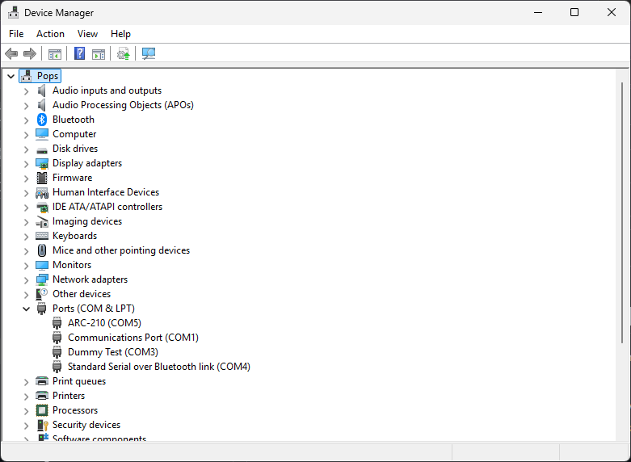
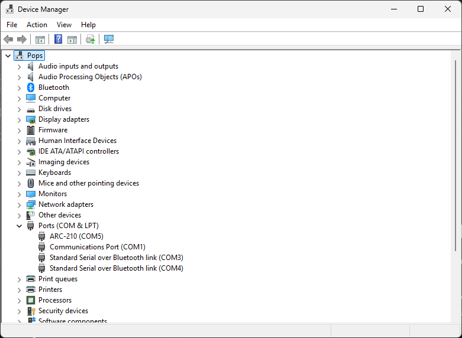

# Windows USB display name utility

**Last updated: November 14, 2026 at 12:16 AM MST (America/Denver)**

These optional scripts set the display name for a serial device listed under **Ports (COM & LPT)** in Windows Device Manager. The default label is **ARC-210 (COMx)**. Use **-Name** or the interactive prompt to choose your own label for a Teensy, USB-to-serial adapter, or another serial device listed there. Windows keeps the assigned COM number.

[Download the rename script](https://github.com/dgdimick/ARC-210-DCS-Display/releases/download/windows-usb-tools-v1/Set-ARC210-USBName.ps1) · [Download the restore script](https://github.com/dgdimick/ARC-210-DCS-Display/releases/download/windows-usb-tools-v1/Restore-ARC210-USBName.ps1)

- `Set-ARC210-USBName.ps1` — MD5 `89d1e2c65d4427ac4ab343a9b79a28d5`
- `Restore-ARC210-USBName.ps1` — MD5 `38a35af76d98421f74c55add24c219e9`

I tested both the rename and restore scripts and the steps for running them in PowerShell as administrator. All three worked on my Windows PC.

## Verify your downloads

Before running the scripts, open PowerShell in the folder where you saved them and run the following command.

```powershell
Get-FileHash -Algorithm SHA256 -LiteralPath .\Set-ARC210-USBName.ps1, .\Restore-ARC210-USBName.ps1
```

Compare the `Hash` shown for each file with the value below. Uppercase and lowercase letters are equivalent.

| Script | Expected SHA-256 |
|---|---|
| `Set-ARC210-USBName.ps1` | `3f688fb8056111f118ab992cdc458ac4dbe61c54886d5920a60d8e1b829b9052` |
| `Restore-ARC210-USBName.ps1` | `5744ea11c196f0ba82b64f3eccb732f39f8ba9cc033059e467b7257a17dd577c` |

If a hash differs, download that file again and recheck it before running it. If the hash still differs, do not run the scripts. Contact me in [GitHub Discussions](https://github.com/dgdimick/ARC-210-DCS-Display/discussions).

## TLDR:

Download both scripts using the links above and save them in the same folder.

Open **Windows PowerShell** as administrator in the folder where you saved the scripts. Replace **COM5** with the COM port you want to use and **ARC-210** with the **name** you want to use.

- **Rename:**

  `.\Set-ARC210-USBName.ps1 -Port COM5 -Name "ARC-210"`

  - **Example:**

    `.\Set-ARC210-USBName.ps1 -Port COM23 -Name "Left Console"`

- **Remove the name:**

  `.\Restore-ARC210-USBName.ps1 -Port COM5`

  - **Example:**

    `.\Restore-ARC210-USBName.ps1 -Port COM23`

## If PowerShell blocks the scripts

If PowerShell says “running scripts is disabled on this system,” open Windows PowerShell as administrator and go to the folder where you saved both scripts. After reviewing the scripts and confirming you downloaded them from the links above, run the following commands.

```powershell
Set-ExecutionPolicy -Scope Process -ExecutionPolicy RemoteSigned
Unblock-File -LiteralPath .\Set-ARC210-USBName.ps1, .\Restore-ARC210-USBName.ps1
```

Run the rename or restore command again in that same window. The execution policy change expires when you close the window. If the scripts are still blocked, run `Get-ExecutionPolicy -List` to check whether `MachinePolicy` or `UserPolicy` is set. Those policies take precedence over the session setting. [Microsoft PowerShell execution policies](https://learn.microsoft.com/en-us/powershell/module/microsoft.powershell.core/about/about_execution_policies/)

## If the device already has a saved rename

PowerShell shows this error when the device already has a saved rename:

```text
This device already has a saved rename. Restore it before applying a new name.
```

In the same administrator PowerShell window, replace `COM5` with the device’s current COM number in Device Manager and run:

```powershell
.\Restore-ARC210-USBName.ps1 -Port COM5
```

Once the restore succeeds, run the rename script again and enter the new name.

## How to rename or restore the port

Use `Set-ARC210-USBName.ps1` to rename the port. Use `Restore-ARC210-USBName.ps1` to put its previous display name back.

For COM5, run this command to restore the previous name. Replace `COM5` with the device’s current COM port if it uses a different number.

```powershell
.\Restore-ARC210-USBName.ps1 -Port COM5
```

1. Download [Set-ARC210-USBName.ps1](https://github.com/dgdimick/ARC-210-DCS-Display/releases/download/windows-usb-tools-v1/Set-ARC210-USBName.ps1) and [Restore-ARC210-USBName.ps1](https://github.com/dgdimick/ARC-210-DCS-Display/releases/download/windows-usb-tools-v1/Restore-ARC210-USBName.ps1) into the same folder.
2. If you have several devices and are unsure which COM port belongs to each one, unplug them and reconnect them one at a time. Check **Device Manager → Ports (COM & LPT)** after plugging in each device. If you want to change its port number, do that in Device Manager first. For example, if you change COM4 to COM23, run the rename script using **COM23**. Then repeat for the next device. If you already know which COM port each device uses in DCS-BIOS, you can use those port numbers directly.
3. Open **Windows PowerShell** using **Run as administrator** and go to the folder where you saved the scripts. Substitute your port for COM5. For example, if your Teensy is on COM5, run the command below.

```powershell
.\Set-ARC210-USBName.ps1 -Port COM5
```

To use a different port and label, pass your COM number and put the name in quotes. In this example, Windows shows **Dummy Test (COM3)**.

```powershell
.\Set-ARC210-USBName.ps1 -Port COM3 -Name "Dummy Test"
```



The script adds the device’s COM number to the end of your label. If you already used the script to rename this device, restore its original name before applying another label.

To undo the rename, enter the device's current COM number from the same administrator PowerShell window. For the COM3 example, use the command below.

```powershell
.\Restore-ARC210-USBName.ps1 -Port COM3
```



Both scripts support COM port numbers above 9. If your device uses COM12, run the first command to rename it to **Left Console (COM12)**. Run the second command when you want to restore its original name.

```powershell
.\Set-ARC210-USBName.ps1 -Port COM12 -Name "Left Console"
.\Restore-ARC210-USBName.ps1 -Port COM12
```

The set script saves the original registry value on the selected device instance. The restore script uses that backup to put the old label back, or uses **Serial Port (COMx)** when there was no original label (**USB Serial Device (COMx)** for a Teensy). A label already set manually before using the utility has no backup from this utility. Both scripts accept `-WhatIf` to preview the operation. Reopen Device Manager to refresh the displayed name.

The rename script saves the backup with the device record. If Windows moves the same device from COM5 to COM17 and resets the label, rerun the rename script on COM17 with the same name. It reapplies the label and keeps the original backup. Run Restore on COM17 to put the original label back with the current port number. After a successful restore, the script deletes the backup from that device record. If Windows creates a new record, Restore looks for a single inactive record with the same hardware and Windows device container IDs. When it finds a match, it restores the original label and removes the backups from both records. If Windows changes those IDs or there is more than one matching old backup, the old backups stay in place.

I moved my ARC-164 to a different USB port on the same PC, and Windows still showed **ARC-164 (COM4)**. Windows used the same device record in both USB ports.

If you run the rename script without arguments, you must type the device’s current COM port (for example, `COM5`) at the port prompt and press Enter. Leaving the port blank causes a validation error. At the name prompt, you can press Enter to use `ARC-210`.

To supply both values directly for a device on COM5, run the following command.

```powershell
.\Set-ARC210-USBName.ps1 -Port COM5 -Name "ARC-210"
```

Run **.\Restore-ARC210-USBName.ps1** with no arguments to enter just the COM port and restore its saved label. If Device Manager shows only **USB Serial Device**, check which port appears in TekConnect or DCSBridge when you plug in the Teensy.

I tested both scripts on COM5. Windows showed **ARC-210 (COM5)** after renaming and **USB Serial Device (COM5)** after restoring. I also tested the custom name on a Bluetooth serial port with the Teensy unplugged. Windows showed **Dummy Test (COM3)** and then restored **Standard Serial over Bluetooth link (COM3)**.
